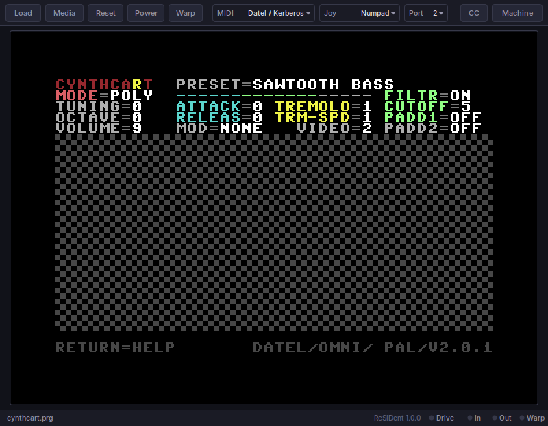
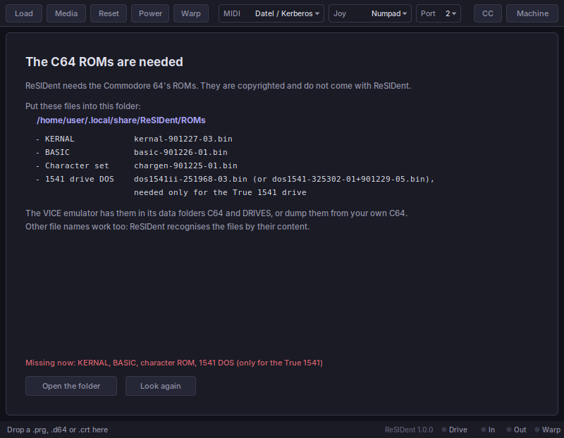
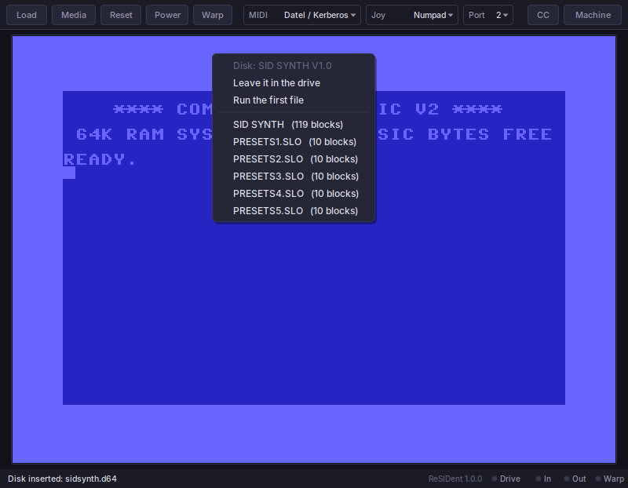
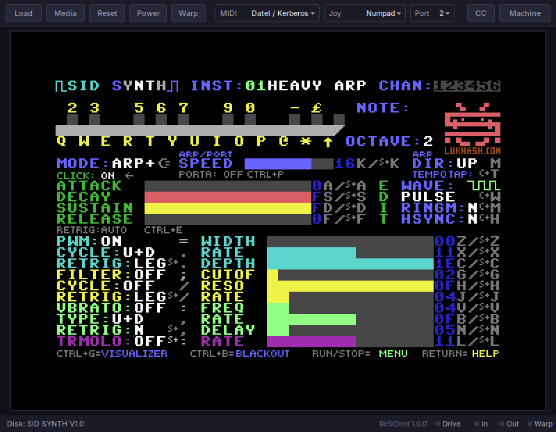
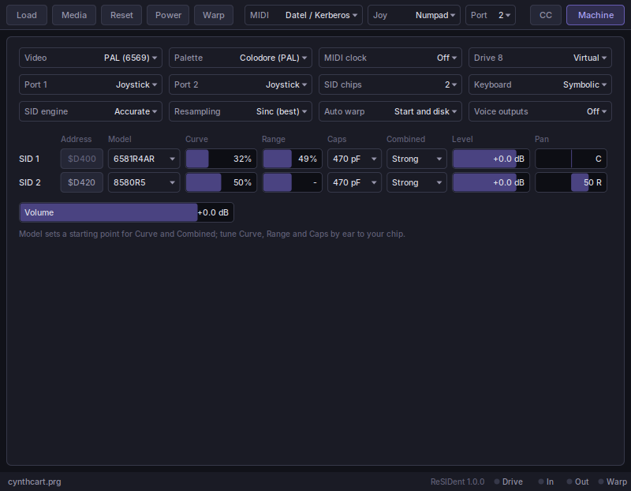
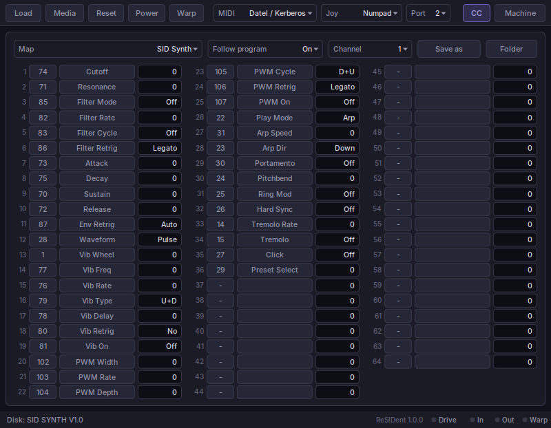

# {{PLUGIN}} — manual

*The original C64 MIDI programs as an instrument: a complete Commodore 64
with up to eight SID chips, a MIDI cartridge in its expansion port, and
your DAW at the other end of the cable. Linux and Windows, CLAP and VST3.*

Version {{VERSION}}

---

[TOC]

## 1. What it is



In the 1980s, musicians plugged a MIDI cartridge into a Commodore 64 and
turned it into a synthesizer with programs written for the purpose. ReSIDent
is that setup inside your DAW. It is not a SID synthesizer of its own: it is
a whole C64 — processor, video chip, timers, disk drive and SID sound chips —
and it runs the **original C64 programs**, unchanged. You play them from
your DAW's notes, and they answer exactly as they did on the real machine,
with their own screens, menus, patches and quirks.

What you get:

- A C64, PAL or NTSC, with a **MIDI cartridge** of the common kinds (Datel,
  Sequential, Passport, Namesoft, Maplin, Moog Song Producer) or the
  **HerMIDI** interface on the serial port.
- **Up to eight SID chips**, each a 6581 or 8580 of a chosen revision, with
  its own filter character, level and pan, and its own output — and, if
  you like, an output for each of its three voices.
- A **disk drive** that loads instantly, or a complete emulated **1541** for
  programs with their own fast loaders. Whatever a program saves goes into
  the disk, which is kept in your project.
- The C64's **keyboard** on your computer keyboard, a **joystick**, and a
  **mouse** or **paddles** on your mouse.
- **CC maps**: the controllers a program listens to, as named, automatable
  parameters in your DAW (chapter 8).
- Your project keeps the **whole machine**: reopen it and the program is
  back exactly where you left it, with every patch you edited on the C64.

ReSIDent contains no Commodore software. You need the C64's ROMs (chapter 3)
and the programs you want to play (chapter 5).

## 2. Installing

Copy the plugin into your host's plugin folder — the `ReSIDent` folder with
the `.clap` inside, or the `ReSIDent.vst3` bundle:

| | CLAP | VST3 |
|---|---|---|
| Linux | `~/.clap/` | `~/.vst3/` |
| Windows | `C:\Program Files\Common Files\CLAP\` | `C:\Program Files\Common Files\VST3\` |

Then let the host rescan its plugins. ReSIDent is an instrument: put it on an
instrument track and play it with notes. The CLAP and the VST3 are the same
plugin; use whichever your host prefers. A `.vst3` is a folder — copy it
whole.

ReSIDent needs a processor with **AVX2 and FMA**: any Intel Core from the 4th
generation (2013) on and any AMD Ryzen. On processors without them the host
refuses to load the plugin.

ReSIDent keeps its own files in `~/.local/share/ReSIDent` on Linux and in
`%APPDATA%\ReSIDent` on Windows: the ROM folder and your CC maps.

### Coming from SidMidi

ReSIDent was called **SidMidi** up to version 0.8.1. It is the same plugin
under a new name, and your projects open in it unchanged. Remove the old
`SidMidi` folder and `SidMidi.vst3` bundle from your plugin folders, so the
host does not find the plugin twice. On its first start ReSIDent copies your
ROMs and CC maps from the old `SidMidi` folder into its own; the old folder
is left as it was, and you can delete it once ReSIDent has started.

## 3. The ROMs



A C64 cannot start without its operating system, which lives in three ROM
chips: the **KERNAL**, **BASIC** and the **character set**. The emulated
1541 drive needs a fourth, its **DOS**. These ROMs are copyrighted and do
not come with ReSIDent.

The first time it runs, ReSIDent creates its **ROM folder** and puts a short
README into it:

- Linux: `~/.local/share/ReSIDent/ROMs`
- Windows: `%APPDATA%\ReSIDent\ROMs`

Copy the ROM files into that folder. The **VICE** emulator includes them in
its data folders `C64` and `DRIVES` (`kernal-901227-03.bin`,
`basic-901226-01.bin`, `chargen-901225-01.bin`, and
`dos1541ii-251968-03.bin` for the drive); you can also read them out of
your own C64. The names do not matter: ReSIDent recognises each file by its
content, so whatever the files are called, and whether they sit in the
folder itself or in subfolders named `C64` and `DRIVES`, they are found.

The window shows what is still missing and has a button that opens the
folder. ReSIDent looks again every two seconds; once the KERNAL, BASIC and
character set are there, the C64 starts by itself. The drive's DOS is only
needed for the **True 1541** drive mode (chapter 7).

A project saved on one computer and opened on another without the ROMs waits
for them: the machine is kept as it was saved and starts as soon as the ROMs
are in place.

## 4. The window

**Load** opens a file chooser for a program: a `.prg` (a C64 program file),
a `.d64` (a disk image), a `.crt` (a cartridge image) or a `.bin` (a raw
cartridge ROM). You can also **drop** a file onto the window. A `.prg` is
loaded and run, a cartridge starts as the C64 is switched on. Starting runs
in warp, muted, so you do not wait for the C64.

A **disk** goes into the drive first, and ReSIDent shows its files: leave it
in the drive, run its first file, or pick the file to run. A disk often
holds more than the program — instruments, songs, a second program — and the
first file is not always the one to start.



**Media** holds the rest of what a C64 user does with disks and cartridges:

- **Insert disk…** puts a disk into the drive and does nothing else: the
  program or cartridge that is running goes on. Load from it on the C64 —
  `LOAD"$",8` and `LIST` show its directory, `LOAD"NAME",8,1` loads a file —
  or from the running program's own disk menu.
- **Start from disk** runs a file of the inserted disk: the C64 is switched
  on and the file is loaded and run.
- **Export disk image…** saves the disk — with everything the program saved
  on it — as a `.d64` file.
- **Freeze** presses the freeze button of an Action Replay or a Final
  Cartridge (chapter 5).
- **Eject disk**, **Eject cartridge**.

A cartridge and a disk can be in at the same time: load a cartridge, then
insert a disk with your sounds or songs, and load them from the cartridge's
program. Starting a `.prg` or a file from the disk takes the cartridge out,
because a C64 with a cartridge starts the cartridge instead.

**Reset** presses the C64's reset button: the program restarts its machine,
the memory survives. **Power** switches the C64 off and on: the program
or cartridge starts again from scratch, a file started from the disk is
started again, and a disk that was only inserted leaves the C64 at READY
with the disk in the drive.

**Warp** runs the machine as fast as it can, muted. Some programs unpack
themselves for a while after loading; Station64, for example, needs about
twelve seconds. The button also lights up when the machine warps on its own
(while a program starts, and while the True 1541 loads); click it then to
stop that warp and watch the load in real time. The next start warps again;
to switch it off for good, see **Auto warp** on the machine page.

**MIDI** is the interface in the C64's expansion port (chapter 6). **Joy**
puts a joystick on your keyboard, **Port** chooses the control port it is
plugged into.

**CC** opens the CC map page (chapter 8), **Machine** the machine page
(chapter 7). Click the button again to return to the screen.

The line at the bottom shows what is loaded, messages, and four lights:
**Drive** (the disk is being read or written), **In** and **Out** (MIDI
going to and coming from the C64), and **Warp**.

The window can be resized; the screen keeps its proportions.

### Typing on the C64

**Click into the screen** to give the C64 your keyboard. From then on, keys
go to the C64 until you click outside the screen or the window loses focus.

How keys become C64 keys is set on the machine page, under **Keyboard**:

- **Symbolic** (the default): a key types the character your keyboard
  prints on it. Type a `;` the way your layout types it — on a German
  keyboard Shift and the comma — and the C64 gets its `;`. SHIFT is pressed
  or held back for the C64 as the character needs. Characters a C64 does
  not have, such as `ä`, do nothing. `^` types the C64's ↑, `_` its ←,
  `\` its £.
- **Positional**: a key is the C64 key in the same place on a C64's
  keyboard, whatever your layout prints on it. Programs that use keys for
  their place rather than their letter — a row of keys as a piano keyboard,
  say — may be easier this way.

Keys without a character work the same in both, and some C64 keys have no
place of their own on a PC keyboard:

| Your key | C64 | Your key | C64 |
|---|---|---|---|
| Esc | RUN/STOP | Tab | CTRL |
| Left Ctrl | C= | Home | CLR/HOME |
| Insert | INST | Delete, Backspace | DEL |
| Page Down | ↑ | Page Up | RESTORE |
| F1–F8 | F1–F8 (even = shifted) | Cursor keys | the C64's cursor keys |

In **Positional** mode the keys around the letters are, on a US keyboard:

| Your key | C64 | Your key | C64 |
|---|---|---|---|
| ` (grave) | ← | - = | + - |
| [ ] | @ * | ; ' | : ; |
| \ or # | = | End, <> | £ |

### Joystick, mouse and paddles

**Joy** puts a joystick on the **numpad** (the digits around 5 are the
directions, 0 or 5 is fire) or on the **cursor keys** (right Ctrl is fire),
plugged into port 1 or 2.

On the machine page, either control port can hold a **1351 mouse** or a pair
of **paddles** instead. Your mouse over the C64's screen then moves it: for
the mouse as a mouse, for paddles the pointer's X and Y are the two knobs;
the left and right buttons are the buttons.

## 5. Programs to play

ReSIDent runs any C64 program, but the ones it is made for are the C64's
MIDI synthesizers. They are not included; get them from their authors.
Four have been tried throughout:

**Cynthcart** by Paul Slocum — a synthesizer with presets, arpeggios and
modulation. It finds the Datel cartridge by itself and answers on every MIDI
channel at once. At its default octave, notes sound an octave lower than
they are played. Download: <https://www.qotile.net/cynthcart.html>

**Station64** by DJ Indikator — a three-oscillator synthesizer with a deep sound engine. It
listens on MIDI channels 1 to 3. It unpacks itself for about twelve seconds
after loading; press **Warp** to skip the wait. It finds a Datel, Passport,
Sequential or Namesoft interface by itself. Download:
<https://ultradaw.com/station64/>, also on CSDb:
<https://csdb.dk/release/?id=139033>

**SID-Wizard** by Hermit — a music editor (tracker) that can be played and sequenced
over MIDI. Its MIDI input is off when it starts: set it to OMNI or to a
channel in its menu. It works with the cartridges and with HerMIDI.
Download: <https://csdb.dk/release/?id=255544>

**SID Synth** by Lukhash — a polyphonic synthesizer with arpeggiator, a bank of 54
instruments and a full CC setup. **Its MIDI is off when it starts:** press
RUN/STOP (Esc) for its menu, choose item 01, and press RETURN until it says
**DATEL** (or the interface you chose in ReSIDent). Then RUN/STOP returns to
the synthesizer. SID Synth comes with Lukhash's album *Neon Airlines*: buy
it at <https://lukhash.bandcamp.com/album/neon-airlines>, and the download
instructions for the synth are inside the album archive.



Most C64 MIDI programs need two things to agree: the **MIDI** interface in
ReSIDent's top bar, and the interface the program itself is set to. When a
program says it cannot find an interface, the two do not match.

### Freezer and fast-loader cartridges

Besides program cartridges, ReSIDent takes the utility cartridges C64 users
kept plugged in: the **Action Replay** (versions 4.2 to 7.5 and their
variants, as `.crt` or as a raw 32K `.bin`), the **Final Cartridge III** and
the **Final Cartridge** (I). Load one like any cartridge; it starts with its
own menu or screen. Insert a disk beside it (**Media → Insert disk**) and
load from the cartridge — that is what their fast loaders are for.

- **Their fast loaders need the True 1541.** They run their own code inside
  the drive, which the virtual drive does not have. When you load such a
  cartridge while Drive 8 is *Virtual*, ReSIDent switches it to *True 1541*
  and says so (it needs the 1541 DOS ROM, chapter 3). A load on the true
  drive runs in warp, so you wait for neither the C64 nor the drive.
- **Freeze**: **Media → Freeze** presses the cartridge's freeze button. The
  running program stops and the cartridge's freeze menu appears — the
  monitor, pokes, sprite killer and so on; its *restart* entry continues the
  program where it stopped.
- **Action Replay**: at its start menu, F7 installs the fast loader, F3
  starts BASIC without it (then even the virtual drive loads, through the
  KERNAL).
- **Final Cartridge III** starts in its desktop, worked with the mouse or a
  joystick; hold **RUN/STOP** (Esc) while it starts to go straight to BASIC
  with its fast loader.

A cartridge and a MIDI interface share the C64's expansion port. ReSIDent
lets both work, as if through an ideal expansion board, including
combinations that clash on a real C64: an Action Replay's register sits
where the *Sequential*, *Namesoft* and *Moog* interfaces have theirs, and a
MIDI program looking for its interface would switch a real Action Replay
into its freeze menu. Here the cartridge hears only its own code, so every
MIDI interface works beside every freezer cartridge.

## 6. MIDI

Notes, controllers, pitch bend, program changes, aftertouch and SysEx from
your DAW go to the C64 as MIDI bytes through the interface chosen in
**MIDI**, at the speed of a real MIDI cable. A program that is too slow to
read them loses bytes, as it would on the hardware.

The interfaces:

| Interface | Notes |
|---|---|
| Datel / Kerberos | The most common one, and the one Kerberos and TeensyROM imitate. Start here. |
| Sequential | Sequential Circuits' cartridge. |
| Passport / Syntech | |
| Namesoft | Signals the C64 by NMI rather than IRQ. |
| Maplin | |
| Moog Song Producer | |
| HerMIDI | An interface on the serial port instead of the expansion port, used by SID-Wizard and Station64. |
| None | No interface. |

**MIDI out**: whatever the program sends — a sequencer's notes, MIDI clock,
patch dumps — comes out of ReSIDent as MIDI, so your DAW can record it or send
it on.

**MIDI clock**: on the machine page, *MIDI clock* set to *From the host*
sends MIDI clock, start, stop, continue and song position from your DAW's
transport to the C64, for programs that follow a sequencer (SID Synth's
arpeggiator, SID-Wizard's playback).

A note on controllers: some programs read only part of the controller
number. Cynthcart treats controllers 16 to 31 as 0 to 15; Station64 treats
64 to 127 as 0 to 63, so a DAW's "reset all controllers" (CC 121) switches
Station64's low-pass filter off, and SID-Wizard stops its tune on it. If a
sound changes when you press stop in your DAW, look for a reset message in
the DAW's MIDI settings.

## 7. The machine page



**Video** — PAL (6569) or NTSC (6567R8). It also sets the C64's clock, and
with it the SID's pitch: a program made for one standard plays slightly out
of tune on the other.

**Palette** — the screen's colours.

**Keyboard** — Symbolic or Positional (chapter 4).

**MIDI clock** — off, or from the host's transport (chapter 6).

**Drive 8** — **Virtual**: instant loading and saving for every program that
uses the C64's normal disk routines. **True 1541**: a complete 1541 drive,
for programs with their own fast loaders; it needs the drive's DOS ROM, and
loading runs in warp. **None**: no drive.

**Auto warp** — when the machine warps on its own, muted: while a program
starts, while the True 1541's motor runs, both (the default), or never.
Turn the disk part off for a game or a demo that loads while it plays: in
warp you would neither hear nor really see it.

**Port 1, Port 2** — joystick, 1351 mouse or paddles (chapter 4).

**SID chips** — how many SIDs the C64 has, one to eight. Programs that use
more than one find the others at their addresses: click a chip's **Address**
to change it.

**SID engine** — **Accurate** or **Light**. Accurate emulates the SID chips
in every detail and is the one to use when your computer can afford it.
Light is a much simpler emulation that needs about a thirtieth of the
processing time per SID, for slower computers, many SIDs or many ReSIDent
instances. It sounds close but not the same: the filter is plainer, digis
(samples played through the volume register) come out rougher, and of the
chip settings below only the model applies, 6581 or 8580. The other
settings keep their values for when you switch back. You can change the
engine while a project plays; the notes that are sounding start over.

**Resampling** — Accurate engine only: how the SIDs' output becomes your
project's sample rate. **Sinc (best)** is clean and is the one to use. **Fast** saves roughly a
tenth to a fifth of the processing time of each SID that is playing,
because it skips the filter that keeps high notes clean; the price is
aliasing, a harsh, metallic edge on bright sounds. Try it when many SIDs
play at once and your computer struggles.

**Voice outputs** — Off, or On: every voice of every SID gets its own
output as well (chapter 9). A SID with voice outputs takes about four times
the processing time, so leave it off unless you route the voices.

### Each SID

**Model** — 6581 (a generic one), 6581R3, 6581R4, 6581R4AR or 8580R5. The
6581, in the first C64s, has a warm, dirty, very individual filter; the
8580, in later ones, is cleaner and more even. Choosing a model also sets a
starting point for Curve and Combined.

**Curve** — how dark (left) or bright (right) the filter is. Real 6581s
differ a lot from chip to chip; this is how you match the one you remember.

**Range** — 6581 only: the filter's range and offset, from dark to bright.
Together with Curve it covers the spread of real chips. Double click for the
default.

**Caps** — 6581 only: the filter capacitors. The earliest C64 boards had
2200 pF capacitors instead of 470 pF, which makes the filter much darker.

**Combined** — how loud combined waveforms (for example sawtooth and
triangle at once) come out: weak, average or strong. Real chips differ here
too.

**Level** and **Pan** — the chip's level and place in the stereo output.
**Volume** under the table is the overall level. These are also parameters
your DAW can automate.

Each chip is set on its own: two 6581s in one C64, or in two ReSIDent
instances, can have different filters.

With the **Light** engine only **Model** applies, as 6581 or 8580 (every
6581 revision is the same 6581 there), together with Level and Pan. Curve,
Range, Caps and Combined are shown greyed out.

## 8. CC maps



C64 MIDI programs listen to MIDI controllers (CC) for their sound: cutoff,
resonance, envelope, waveform. Which controller does what is different in
every program. A **CC map** says it for one program, and ReSIDent turns it
into **parameters**: 64 slots, which your DAW shows by the names in the map —
*Cutoff*, *Resonance*, *Attack* — and can automate, map to a hardware
controller, or put on a macro.

Moving a slot sends its controller to the C64 at that exact moment. A slot
only sends when its value changes, and nothing is sent when a project is
opened or a map is chosen. The slots show what was last sent, not what the
program currently has: a program's own settings are not read back.

### Choosing a map

**Map** lists the maps that come with ReSIDent (for Cynthcart, Station64,
SID-Wizard and SID Synth, at the end of this manual) and your own. With
**Follow program** on, loading a program picks the map made for it by its
file name — load SID Synth, and the slots become SID Synth's controllers.
A file started from a disk is matched by the disk's file name and by the
program's own name on the disk.
Your own map for a program is preferred over the built-in one.

When the map changes, the slots are renamed in your DAW. Automation stays on
the slot it was recorded on: slot 1 is slot 1 in every map. Most DAWs show
the new names at once; a few only after the plugin's window or the track is
reopened.

The map in use is saved in your project, so a project keeps its names even
on a computer without your map file.

### Editing a map

**Channel** is the MIDI channel the slots send on.

Click a slot's **controller number** to change it. Type the number (`74`),
or the number and a channel (`74@2`) for a slot that sends on its own
channel. An empty entry clears the slot.

Click a slot's **name** to rename it. Value names go after a `|`, each with
the value it starts at: `Vib On | 0 Off, 64 On` shows *Off* from 0 to 63 and
*On* from 64 up. Your DAW then shows those names, and you can type them.

**Save as** stores the map in your CC map folder under a name you choose;
**Folder** opens that folder:

- Linux: `~/.local/share/ReSIDent/CC Maps`
- Windows: `%APPDATA%\ReSIDent\CC Maps`

A map is a plain text file, one line per slot:

```
name = My SID Synth
programs = sidsynth
channel = 1
1 = 74 Cutoff
2 = 71 Resonance
3 = 85 Filter Mode | 0 Off, 32 LP, 64 BP, 96 HP
4 = 28@2 Waveform
```

`programs` lists words that, found in a loaded file's name, make *Follow
program* pick this map. Lines starting with `#` are comments. Edit maps in
any text editor; ReSIDent reads the folder again whenever the CC page opens.

SID Synth lets you reassign its controllers in its own MIDI CC SETUP screen.
If you do, change the map to match and save it as your own.

## 9. Outputs

A stereo **main output** with every SID at its level and pan, and **one mono
output per SID**, for a separate mixer channel or effect chain per chip.
Which outputs your DAW offers, and how they are routed, is set in the DAW.

**Voice outputs.** With **Voice outputs** on (machine page), each of the
three voices of every SID comes out on its own mono output as well: *SID 1
Voice 1* to *SID 8 Voice 3*, 24 in all. Record them on separate tracks and
treat each voice on its own. A voice keeps its share of the SID's sound —
it goes through the chip's filter and volume just as in the chip — but each
voice through a filter of its own. A SID's filter and mixer saturate a
little when several loud voices play at once, the 6581 much more than the
8580: that grit is part of the chip's sound and lives in the sum, so the
three voice outputs mixed together sound cleaner than the SID's own output,
and a 6581's a little louder too. Digitised sounds played through the
volume register reach the voice outputs only in part. The per-SID output
stays the real thing.

The per-SID and voice outputs carry the chip's own signal: the machine
page's **Level**, **Pan** and **Volume** shape the main output only. With
voice outputs off, the 24 voice outputs are silent.

## 10. Projects

Saving a project saves the whole C64: memory, every chip, the disk with what
the program saved on it, the cartridge (both at once, if both are in), the
machine page's settings, the CC map and the slots. Reopening the project puts the program back exactly where
it was, mid-note, with all your edits — nothing needs to be loaded again.

To keep a disk outside the project, use **Media → Export disk**.

Each ReSIDent in a project is a separate C64: settings in one never change
another.

## 11. Processor load

Measured on a 2021 laptop processor, as a share of one core: the C64 itself
costs a few percent, a little more while its window is open (the screen is
only drawn then). Each SID that plays adds about 4-6 % on the **Accurate**
engine (an 8580 a little less than a 6581) and about 0.2 % on **Light**;
SIDs that a program never touches cost nothing. With all eight SIDs playing,
expect around a third to a half of a core on Accurate and about a twentieth
on Light. Voice outputs (chapter 9) multiply
a SID's share by about four. *Fast* resampling (chapter 7) brings Accurate
down a little; the **Light** engine is the big step.

When your DAW renders a project offline, ReSIDent runs the C64 at a fixed
pace, so two renders of the same project are identical.

## 12. When something does not work

- **No sound when playing notes.** Is the MIDI light **In** flashing? If it
  is, the program has not been told about the interface: set its MIDI on in
  its own menu and check that it matches **MIDI** in the top bar (chapter 5).
- **The program says it finds no MIDI interface.** Choose another interface
  in **MIDI** — Datel first — and tell the program to look again, or press
  **Power** to start it fresh.
- **The window shows the ROM page.** The ROMs are missing or incomplete
  (chapter 3). The page lists what is still needed.
- **The wrong program starts from a disk.** Load the disk again and pick the
  file, or use **Media → Start from disk**.
- **A program does not load from the disk.** It may use its own fast loader:
  set **Drive 8** to **True 1541** (this needs the drive's DOS ROM) and load
  it again.
- **Keys do nothing on the C64.** Click into the screen first; the window
  has to have the keyboard.
- **The sound changes when the DAW stops.** The DAW sends "reset all
  controllers" on stop, which some programs take as a sound change
  (chapter 6).
- **Crackles or dropouts with many SIDs or instances.** Your computer is
  running out of time: switch the **SID engine** to **Light** (chapter 7),
  turn off voice outputs you do not route, or close ReSIDent's windows.
- **A slot's name did not change in the DAW.** Reopen the plugin's window or
  the track; some DAWs only read parameter names then.

## 13. Licence and credits

ReSIDent is free software under the **GNU General Public License, version 2
or later**. Its Accurate SID engine is **reSIDfp** (libresidfp) by Dag Lem,
Antti S. Lankila and Leandro Nini, under the same licence, with changes of
ReSIDent's own: each SID has its own filter state (range, capacitors and
the filter's dither), so chips and instances never affect each other, and a
voice can be heard on its own (voice outputs). Its Light engine is
**SIDLite** from libsidplayfp by Leandro Nini, based on **cRSID** by Mihaly
Horvath (Hermit), under the same licence, changed so that it keeps exact
time and pitch at every sample rate, can be saved with a project, and
has voice outputs too. The
screen palettes come from the VICE project (GPL). The HerMIDI interface runs
the original HerMIDI firmware by Mihaly Horvath (Hermit), from the
SID-Wizard package.

Commodore 64, C64, SID, 1541 and the names of the MIDI interfaces are
names of products of their respective owners. ReSIDent is not affiliated
with or endorsed by any of them, and contains no Commodore software.

## Appendix A. The CC maps that come with ReSIDent

The values column gives the value names a slot shows; a slot without them
sends the number as it is.

{{PRESET_LIBRARY}}

## Appendix B. Every parameter

{{PARAMETER_SUMMARY}}
