# SäureKiste — manual

*A monophonic acid bass synthesiser. Linux and Windows, CLAP and VST3.*

Version 0.17.0

---

[TOC]

## 1. What it is

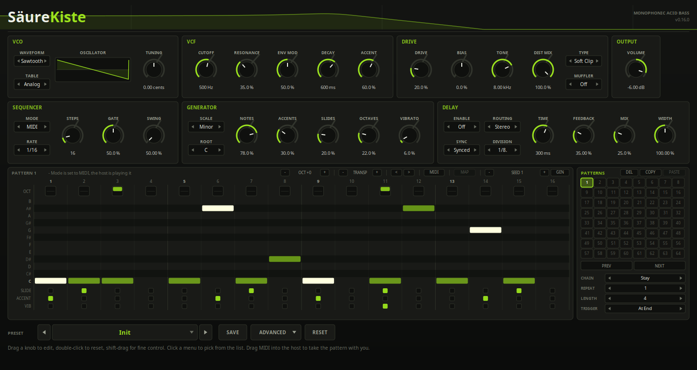

SäureKiste models the main board of the popular silverbox — the little bass
machine every acid record was made on — as its February 1982 service notes
draw it: a relaxation-oscillator VCO, a four-stage transistor
ladder filter, a VCA, a decay-only envelope, an accent circuit, and a slide lag
on the pitch CV. Two stages are added that the machine does not have — a drive
stage of ten models after the filter, and a delay after that — and both are
marked as such everywhere they appear. After all of it there is an
**effect chain** of up to sixteen inserts, which can also sit between the
oscillator and the filter -- §9.

The oscillator has additions of its own, for the experimental end of the
instrument: five more waveforms — sine, triangle, pulse, wavetable and noise —
each with a control of its own and a display that shows the cycle the
oscillator is making, eight built-in wavetables plus a folder of your own, and
**unison** of up to sixteen voices spread across the stereo field. The machine's own sawtooth and square are untouched by any of it, and
with one voice the instrument is as mono as the machine.

It is **monophonic** and it tells the host so.

It plays two ways: from the host, or from its own sequencer, which runs 1 to 128
steps and draws on a bank of sixty-four patterns.

It also models a well-known hardware **modification** of the same machine, from
its author's own published manual — see §11. Every one of those controls
defaults to the stock circuit, so the plugin is the original until you ask it
not to be.

Two hundred and fifty-two parameters -- seventy-four on the panels and the rest
for the sixteen effect slots -- thirty presets, and every one of the parameters
can be automated and modulated from the host.

Not affiliated with or endorsed by Roland Corporation. *TB-303* is their
trademark, used here only to name what was modelled. Not affiliated with or
endorsed by Robin Whittle; *Devil Fish* is his, and is used only to name the
modification that was modelled.

## 2. Playing it

**Mode** decides where the notes come from.

In **MIDI** the host plays it, and the two things the machine's sequencer used
to say per step are recovered from what a piano roll already has. In
**Sequencer** the plugin plays its own pattern and a held MIDI note transposes
it. In **Live** it plays its own pattern too, but the keys select patterns
instead of transposing — see §6.

Everything below applies to both.

### Accent

In MIDI mode, a note whose velocity is **at or above the Accent At threshold**
(100 by default) is accented; in Sequencer mode it is the step's accent bit. Everything below it is not. It is a switch and not a
curve, because the hardware's accent was one bit per step.

An accented note is three things at once:

- **louder**, by the amount the Accent knob sets;
- **brighter**, because the accent circuit adds to the filter's cutoff CV;
- **shorter**, because the ACCENT line gates an analog switch onto the envelope
  node and bypasses the Decay knob entirely. On the hardware this is not
  optional; a later modification made it switchable, which tells you how
  strongly people felt about it.

The brightness does not stop when the note does. The accent charges a capacitor
which then discharges over **68 ms** — long enough that a note landing a
sixteenth later is still sitting in the tail of it. That is where an acid line
gets its breathing quality, and **Sweep Time** is that time constant.

### Slide

**Overlap two notes** and the second slides from the first. Extend a note in the
piano roll so it runs past the start of the next one; in Sequencer mode, tick
the step's Slide box and the sequencer does the overlapping for you.

What matters is what does *not* happen: nothing retriggers. The filter envelope
carries straight on through the join and the amplifier does not start again,
because on the machine a slid step holds the gate high and never fires a new
trigger. A slide is therefore audibly different from two legato notes.

Releasing the upper of two held notes slides back down to the lower one, for the
same reason.

## 3. The controls

Eight are the machine's front panel: Waveform, Tuning, Cutoff, Resonance, Env
Mod, Decay, Accent and Volume. Those eight are the window the plugin opens
with, laid out in the order the machine prints them. Everything else is an
addition: the VCO panel's Table and oscillator display sit beside the
originals and are marked **(added)**, as is Slide Time, the VCF Mod, Drive, Delay, Unison,
Vibrato and Mods panels are additions entire and say so in their headings, and
the controls of the modification are gathered in §11.

**Every knob glides.** A turned knob, or a host's automation, reaches the sound
over a few milliseconds rather than in one step — 63 % of the way in 20 ms —
the way a pot on a circuit board moves a voltage. A fast sweep of Cutoff is
therefore one continuous sweep, not a staircase of small jumps that can be heard
as a zipper under the note. The switches (Waveform, Type, Muffler and the like)
and the time controls (Decay, Slide Time and the rest) take effect at once,
because they have nothing to glide through. So does everything a preset sets
when it loads onto a silent instrument.

### VCO

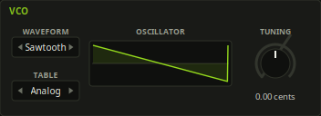

| Control | Range | Default | |
|---|---|---|---|
| **Waveform** | Sawtooth / Square / Sine / Triangle / Pulse / Wavetable / Noise | Sawtooth | Switch S1. The sawtooth falls rather than rises — the oscillator is an integrator that ramps down and is snapped back up. The square arrives at the filter **6.7 dB down**, because the schematic prints both swings: 12 V to 5.5 V for the saw and 8 V to 5 V for the square. That difference is reproduced rather than normalised away. The other five are added; see below. |
| **Table** *(added)* | Analog … Resonant, User | Analog | Which wavetable the Wavetable waveform reads. Clicking its name opens the wavetable selector; see *Wavetables* below. |
| **Oscillator display** *(added)* | | | A picture of the cycle the oscillator is making, where a knob would be. It edits the control that belongs to the selected waveform — its label says which — and is dragged, wheeled and typed into like any knob. |
| **Tuning** | ±700 cents | 0 | VR2. The service notes give its travel as approximately a perfect fifth either way. |

#### The added waveforms and their controls

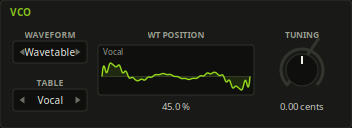

Each added waveform has one control of its own, and each is an ordinary
parameter: the host lists it by name and can automate and modulate it, and a
lane drawn for one never moves another when the waveform changes. None of them
touches the sawtooth or the square — those are the machine's.

| Waveform | Control | Range | Default | What it does |
|---|---|---|---|---|
| **Pulse** | **Pulse Width** | 3 – 50 % | 50 % | The width, as a share of the cycle. At 50 % it is exactly the square, at the square's level and with its droop; turning it down narrows the pulse to a 3 % needle. |
| **Wavetable** | **WT Position** | 0 – 100 % | 0 % | Where in the table it plays. Neighbouring frames are crossfaded, so a sweep morphs smoothly from one end of the table to the other. |
| **Triangle** | **Tri Skew** | 0 – 100 % | 0 % | Leans the apex towards the start of the cycle, until at 100 % it is nearly a falling ramp — the machine's own direction. |
| **Sine** | **Sine Bend** | 0 – 100 % | 0 % | Bends it by phase distortion: the first half of the cycle is run through faster than the second, adding harmonics smoothly from none at all to a bright, buzzy edge. |
| **Noise** | **Noise Grain** | 0 – 100 % | 0 % | How long each random value is held. At 0 % it is white noise; towards 100 % it gets coarser, and at the top it changes once per cycle of the note — pitched, digital noise that follows the keyboard and slides like any note. |

The display shows one cycle of what the oscillator is making, drawn from the
same shape code the sound comes from, and edits whichever of the five belongs
to the selected waveform; with the sawtooth or the square it only shows. It
follows its control whether you turn it, a host automates it or a host's
modulator moves it. The pulse is drawn about its own average, which is where
the square's droop puts it, and the square is drawn at its real, quieter level.

#### Wavetables

Eight tables come with the instrument, each a sweep of one idea from its
plainest frame at WT Position 0 % to its most extreme at 100 %:

| Table | From … to |
|---|---|
| **Analog** | Saw, then square, then triangle, then sine. |
| **PWM** | A square narrowing to a thin pulse. |
| **Vocal** | Through the vowels a, e, i, o, u. Like every formant table it moves the formants with the note. |
| **Additive** | One harmonic at a time, from a sine to forty-eight of them. |
| **Sync** | A ramp hard-synced to the note, its own pitch climbing three octaves. |
| **FM** | Two operators at the same frequency, the modulation index rising to 6. |
| **Fold** | A sine driven into more and more folds. |
| **Resonant** | A ramp with a resonant peak sweeping up through it — a filter sweep frozen into the table. |

**Your own wavetables** live in a folder beside your presets:

- Linux: `~/.config/SaeureKiste/wavetables` (under `$XDG_CONFIG_HOME` if that is set)
- Windows: `%APPDATA%\SaeureKiste\wavetables`

The folder is made the first time the selector opens. Put WAV files in it, in
subfolders if you like, and they appear in the selector the next time it opens.

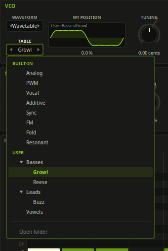

**The selector.** Click the Table chip's name and the selector opens under it:
the built-in tables, then your folder as a tree, each subfolder opening and
closing with a click. Picking a table loads it, switches the waveform to
Wavetable, and **leaves the list open**, so you can click through tables while
a pattern plays; click outside it or press Escape to close it. The chip's
**arrows** (and the mouse wheel over it) step through every table in the same
order, yours included, without opening anything, and the chip shows the name
of the one that is playing. At the bottom of the list, **Load file...** reads a
WAV from anywhere, and **Open folder** shows the wavetable folder in your file
manager.

The files are WAV — 8, 16, 24 or 32-bit, or 32-bit float, mono or the left
channel of a stereo file. How long one frame is:

- if the file says so itself, as files from most wavetable editors do, that is
  believed;
- otherwise a file that divides into 2048-sample frames is a table of them, which
  is the common convention;
- and anything shorter than 4096 samples is one single cycle, of whatever length.

A table can have up to **64 frames**; a file with more is thinned evenly across
its length. If a file cannot be read, the display says why in red for a few
seconds and nothing changes.

The table in use is **saved with the project**, and in any preset saved while
Table is on User, so neither depends on the WAV file still being where it was —
renaming or moving the file later changes nothing in a song that used it.
Loading a preset that has no table of its own leaves the loaded one where it
is. Which user table is playing is chosen in the selector rather than by a
parameter, because the list is whatever is in your folder; everything else
about the oscillator, WT Position included, is automatable.

All wavetables are band-limited per octave, so a high note does not fold its
harmonics back down into the audible range.

### Unison *(the whole panel is added)*

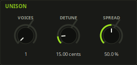

Copies of the oscillator, detuned against each other and spread across the
stereo field. The stack is still one note: it slides, accents and decays as one,
through one filter envelope and one amplifier envelope, and every waveform
stacks — including the wavetables and the noise.

| Control | Range | Default | |
|---|---|---|---|
| **Voices** | 1 – 16 | 1 | How many copies play each note. One is the machine. The level stays about the same however many there are. |
| **Detune** | 0 – 100 cents | 15 cents | How far the outermost voices are tuned from the note, one up and one down; the rest sit evenly between. A few cents thickens, twenty-five is a chorus, a hundred is a cluster a semitone wide either side. |
| **Spread** | 0 – 100 % | 50 % | How far across the stereo field the voices go, the most detuned the widest. |

With Spread above zero each side of the stereo field gets **its own filter and
drive** — the voices panned left go through one ladder, those panned right
through another — so the two channels stay different all the way through the
instrument rather than being widened at the end. The two halves add up to the
unspread stack, so a spread patch folds down to mono cleanly. At Spread 0 %, or
with one voice, there is one filter and the output is mono.

### VCF

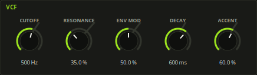

| Control | Range | Default | |
|---|---|---|---|
| **Cutoff** | 30 Hz – 5 kHz | 500 Hz | VR3. The centre is 500 Hz because the factory alignment procedure puts it there: with cutoff centred and resonance full, TM3 is trimmed until the filter rings at 2 ms ± 0.5 ms, and 2 ms is 500 Hz. The machine's own travel is 100 Hz – 2.5 kHz; the wider range is the modification's — see §11. |
| **Resonance** | 0 – 100 % | 35 % | VR4. It stops just short of oscillation, because the machine does — the ringing waveform printed for that alignment check dies away. A silverbox that sustains a tone is a modified one. |
| **Env Mod** | 0 – 100 % | 50 % | VR5, and the one control that does two things at once. See §4. |
| **Decay** | 30 ms – 3 s | 600 ms | VR6. The envelope has no attack worth the name and no sustain at all — it is triggered and it falls. An accented note ignores this knob. The schematic's own range is 200 ms – 2.5 s; the wider one is the modification's — see §11. |
| **Accent** | 0 – 100 % | 60 % | VR7, and the sixth knob on the machine's own panel. How much louder, brighter and shorter an accented note is. What an accent *is* — which velocities count as one, how long it lingers, how a run of them stacks up — is on the MODS panel behind ADVANCED. |

### VCF Mod *(the whole panel is added)*

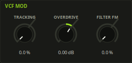

Three controls that reach the filter and that the machine does not have. The
last two are the hardware modification's and are described in §11.

| Control | Range | Default | |
|---|---|---|---|
| **Tracking** | 0 – 200 % | 0 % | Filter key follow. The machine has **none**: its pitch CV reaches the oscillator and stops, so a note two octaves up meets the same filter as the root. 0 % is the machine, 100 % is one-for-one, and past that the filter climbs faster than the note. |
| **Overdrive** | −60 – +36.5 dB | 0 dB | The oscillator's level into the filter. See §11. |
| **Filter FM** | 0 – 100 % | 0 % | The amplifier's output back into the filter frequency, at audio rate. See §11. |

### Slide

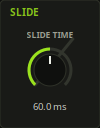

| Control | Range | Default | |
|---|---|---|---|
| **Slide Time** *(added)* | 10 – 360 ms | 60 ms | Fixed on the hardware by C35 (0.22 µF) and its resistor network; a control here because the notes now come from a host. 60 ms is where the original sits, and the travel past 300 ms is the modification's — see §11. |

### Drive *(the whole panel is added)*

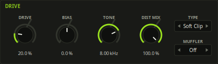

| Control | Range | Default | |
|---|---|---|---|
| **Drive** | 0 – 100 % | 20 % | How hard the model is worked. What it actually moves depends on the model: Schetzen's thresholds, Bendiksen's `dist`, a triode's saturation, a bit depth. |
| **Bias** | −100 – +100 % | 0 % | Where the model sits on its own curve. At the centre each one is at the operating point its source specifies; away from it the two halves of the wave are treated differently, which is what puts even harmonics into a sound that otherwise has only odd ones. |
| **Tone** | 800 Hz – 18 kHz | 8 kHz | A lowpass after the drive. At the top of its range it does nothing. |
| **Type** | 10 models | Soft Clip | Which model the stage is. See below. |
| **Dist Mix** | 0 – 100 % | 100 % | How much of the driven signal is heard against the clean one. At zero the stage is bypassed however Drive and Type are set. |

#### The ten models

Everything in front of this stage is fixed by the service notes. There is no
schematic for the stage itself, so seven of the ten are built the other way
round — from the literature, every one an equation out of a named source. The
other three are built from circuits, and are described under the table.

- **[DAFX]** U. Zölzer (ed.), *DAFX: Digital Audio Effects*, 2nd edition, Wiley
  2011, chapter 4, *Nonlinear processing* (Dutilleux, Dempwolf, Holters,
  Zölzer).
- **[Pirkle]** W. Pirkle, *Designing Audio Effect Plugins in C++*, 2nd edition,
  Routledge 2019, chapter 19, *Nonlinear Processing: Distortion, Tube
  Simulation, and HF Exciters*.
- **[ESmash]** ElectroSmash, *MXR Distortion+ Analysis* — a
  component-by-component reading of that pedal, with the corner frequencies
  worked out.

| Type | Source | What it is |
|---|---|---|
| **Soft Clip** | — | The stage this instrument has always had: a rational tanh. The default, so a preset written before the models existed sounds exactly as it did — and the loudest of them at any given Drive, because its gain reaches 24 and it is compressing hard by the middle of the knob. |
| **Overdrive** | [DAFX] eq 4.14 (Schetzen) | Symmetrical soft clipping in three zones: **linear** below a third of full scale, compressing to two thirds, flat above. The linear zone is the point of it — a note stops being distorted as it decays, so the stage follows the playing instead of flattening everything equally. |
| **Tube** | [DAFX] eq 4.13 (Bendiksen) + M-file 4.4 | Asymmetric soft clipping around a work point: roughly linear for positive values and hard-limited for negative ones. At the book's own Q = −0.2 the positive half reaches 0.95 and the negative is held at 0.25, and almost all of its harmonics are even. The M-file's highpass and lowpass are in the path too. |
| **Valve Stack** | [Pirkle] 19.12, 19.13 | Four class-A triode stages in series, each with the DC-removing highpass and the cathode-bypass shelf the book gives them, and the two-band tone stack it puts between the third stage and the fourth. The one model with a frequency response of its own: thinner at the bottom, brighter at the top. A power stage after the cascade keeps it inside its bounds, which is what a real one has too. |
| **Fuzz** | [DAFX] eq 4.15 + [Pirkle] FEXP1, eq 19.2 | Exponential from the first volt — no linear region at all, which is what "fuzz" means. Asymmetric by default, because both sources describe it that way: the Fuzz Face clips its negative half lower than its positive one. |
| **Rectifier** | [DAFX] 4.3.3, [Pirkle] table 19.2 | Folds the negative half of the wave onto the positive one, which doubles the number of zero crossings and therefore the fundamental. An octave *over* the note rather than an edge on it, and the only model here that changes the pitch of what it is given. Bias runs it from half-wave to full-wave. |
| **Crush** | [Pirkle] eq 19.1 | Quantised to fewer bits, twelve down to three. Digital rather than a circuit, and unmistakable. |
| **Germanium** | the pedal's schematic + [ESmash] | A 1970s stompbox, modelled component by component. The one model here that distorts part of the spectrum and leaves the rest alone. |
| **Crunch** | a 1993 pedal's service notes | One channel of a two-channel overdrive: a single stage with an asymmetric clipper in its feedback loop, clipping high enough that it stops distorting as a note decays. |
| **Lead** | the same service notes | The other channel of the same pedal, and a different circuit: three gain stages with two clippers between them. Saturated, compressed and narrow. |

A hard model is made usable with **Dist Mix**: Fuzz or Rectifier at 25 % adds
something to a line that is otherwise still the machine.

**Germanium is the odd one out**, and deliberately. The other seven are
equations; this one is a circuit — a distortion pedal from the middle 1970s,
whose schematic is a published document in the same way the silverbox's own
service documentation is, and which is modelled the same way: component by
component, with every value read off the drawing.

What makes it worth having is not that it is a pedal. It is the one model here
whose gain is **not the same at every frequency**. A 47 nF capacitor in the gain
stage's lower leg means the circuit has unity gain at the bottom and its full
gain — up to 46 dB — only above a corner that the Drive knob moves with it. Turn
Drive up and the corner climbs from 3 Hz to 720 Hz while the gain climbs with
it, so what gets distorted is the harmonics and what is left alone is the
fundamental. Every other model in this table distorts a bass note and its
overtones equally, and on this instrument that is what thickens a line until it
loses its bottom. This one does not: it stays tight down low and takes its edge
from the top, which is why it sits differently in a mix from anything else here.

The rest of it is the circuit too. The op-amp is an old, slow one, and at full
gain it cannot follow above about 4.7 kHz — so the response is a broad hump in
the middle rather than a shelf, and the published analysis of the pedal measures
that hump at 1.5 kHz. The clipping is a pair of germanium diodes wired *across*
the signal path behind a 10 kΩ resistor rather than in a feedback loop: they do
not clamp the signal so much as load it, which is a much softer thing to do, and
germanium starts conducting at about a third of the voltage silicon does.

**Bias** does something specific here. The schematic carries a note beside the
two diodes suggesting an array with two one way and one the other — the
asymmetric-clipping modification people have been doing to these for decades.
Centred, Bias is the matched pair the pedal shipped with; either way from centre
puts a second diode in series on that side, clipping at twice the voltage and
putting even harmonics in.

**Crunch and Lead are one pedal**, a dual overdrive from 1993, and two models
because the pedal's mode switch does not re-voice a chain — it picks between
two complete ones, each with its own gain, tone and level. Putting both in this
list keeps a switch off a panel with no room for one.

*Crunch* is a single stage with the clipping diodes in its feedback loop rather
than across the path, and with an unusual pair in there: an LED and a silicon
diode in series one way against an LED alone the other. That puts the
thresholds at about 2.2 V and 1.6 V, where most overdrives clip at 0.6 — high
enough that the stage plays clean until you hit it, and stops distorting
altogether as a note decays. It is the one model here that gets out of the way.

*Lead* is the other extreme: three gain stages with two clippers between them —
red LEDs shunt to ground, then asymmetric silicon in a feedback loop — and a
lowpass after every one. There are six thousand times the gain before the first
clipper, so it is saturated wherever you put the knob, and everything below a
couple of hundred hertz has been filtered away before it gets there. Narrow,
compressed and sustaining, which is what a lead channel is for. It will not do
a bass line on its own; it is very good under one at a low Dist Mix.

Both were built from the pedal's service notes, which end with photographs of
its output fed a 200 Hz square. Those two pictures are the test: one keeps a
tall spike and sags towards the next edge, the other is flat and ringing, and
the models are held to the same difference.

**Both sources say the same thing about aliasing** — a nonlinearity needs
oversampling ([DAFX] 4.1.1 and figure 4.5, [Pirkle] 19.1) — so every model here
runs at twice the sample rate with an interpolating filter on the way in and a
band-limiting one on the way out. Soft Clip is the exception, and deliberately:
it is the stage that predates all of this and it renders what it always did.

**Why ten and not fourteen.** There were fourteen, once, and they all sounded
the same. Any two memoryless clippers driven hard enough become the same square
wave; matching their levels removes what little is left; and none of them had
any filtering of its own. What tells these apart is that they are built
differently — a linear region that survives, an operating point off centre,
four stages in series with a tone stack between them, a rectifier, a quantiser,
a gain that depends on frequency — and it is measured rather than taken on
trust: each model's Drive is set to
wherever it gives 25 % total harmonic distortion, and the harmonics it makes
there are compared with the others'. Any two clippers meet at the top of the
knob, so that is the setting where a difference has to show if it is real.

### Delay *(the whole panel is added)*

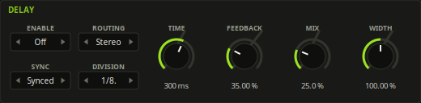

The machine has no delay and never had one. This is the second stage here that
comes out of the literature rather than off the schematic — the first is the
drive — and it sits after everything else, where a box plugged into the back of
the machine would have sat.

| Control | Range | Default | |
|---|---|---|---|
| **Enable** | Off / On | Off | Whether the stage is in the path. Off is a true bypass, but the lines keep what is in them, so switching back on carries on rather than starting from silence. |
| **Sync** | Free / Synced | Synced | Where the time comes from: the Time knob, or the host's tempo and the Division chip. |
| **Time** | 20 – 2000 ms | 300 ms | The delay time when Sync is Free. Does nothing when it is Synced. |
| **Division** | 1/32 – 1/2 | 1/8. | The delay time as a note value, when Sync is Synced. |
| **Feedback** | 0 – 130 % | 35 % | How much of each repeat makes the next one. See below. |
| **Mix** | 0 – 100 % | 25 % | The repeats against the dry instrument, as a crossfade. At 100 % the instrument itself is gone. At zero the stage is bypassed. |
| **Routing** | Mono / Stereo / Ping-Pong | Stereo | How the two lines are wired. See below. |
| **Width** | 0 – 200 % | 100 % | How far the repeats are spread, over the delay's own output only — the dry instrument does not move. Nothing to do in Mono. |

**The three modes.** Mono is one line heard in both channels; the repeats sit
where the instrument does. Stereo is two lines, the right one running at two
thirds of the left, so the repeats interleave — two lines at the *same* time
would not be a stereo delay at all, only a wider mono one. Ping-Pong sends the
instrument into the left line and crosses the feedback, so each repeat walks
from one side to the other and back.

That last one is the one place the implementation leaves its source. The book's
figure crosses the *inputs* as well, which works for a stereo source and does
nothing at all for a monophonic one: both lines would be fed the same signal,
both taps would stay equal for ever, and the mode would be the mono delay with
extra arithmetic. What the figure is actually for is that the first repeat
lands on one side and the second on the other, and that is what you get.

**Feedback above 100 %**, and why it does not blow up. Up to 100 % the stage is
the IIR comb filter its source prints, and the repeats die away. Past it they do
not: the source states the stability condition outright — above unity "the
signal would grow endlessly" — and that is broken here on purpose. What holds
the loop up instead is the same soft clipper the instrument's own output stage
uses, inside the feedback path. The repeats grow, saturate, and then sit there
as a self-oscillating drone that can be played over. It cannot run away, and it
will not stop by itself either: Enable off, or Mix at zero, is how it is
stopped.

**Turning Time while it runs** bends the repeats rather than clicking. The read
head glides to a new setting over about 50 ms, which is a tape delay's behaviour
and is worth having on purpose; a host moving the tempo under a synced delay
does the same thing. Mix, Feedback and Width glide as every other knob does,
and Enable off fades the repeats out over the same few milliseconds instead of
cutting them.

### Output

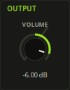

| Control | Range | Default | |
|---|---|---|---|
| **Volume** | −60 – 0 dB | −6 dB | VR8. It stops at unity rather than offering makeup gain, because the service notes give the output stage's gain as unity and there is nothing above it. |

### Mods *(the whole panel is added)*

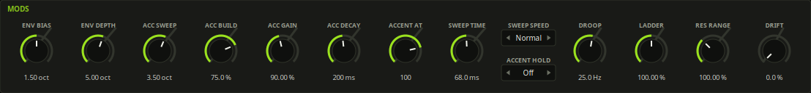

Ten numbers that the schematic does not give. They used to be constants in the
engine, which meant shipping one particular guess; they are controls instead,
with those guesses as their defaults. Nothing moved — a preset that does not
mention them sounds exactly as it did.

Four more sit with them, because they are the same kind of thing: **Accent At**,
**Sweep Time**, **Sweep Speed** and **Accent Hold** say what an accent *is*,
and nobody re-decides that while playing. The Accent knob on the front panel
says how much of it to apply, and that is the one that stays in reach.

They are also close to the list of things people soldered into their own
machines, and there is a reason that list is short and specific: no two of these machines
agreed anyway. Matched transistor pairs, a posistor and twenty years of drift
saw to that, so “the” silverbox sound was never one sound. This is where you pick
yours.

| Control | Range | Default | |
|---|---|---|---|
| **Env Bias** | 0 – 3 oct | 1.5 | How far Env Mod drops the resting cutoff as it deepens the sweep — the size of Q9's trick (§4). At **zero the gimmick is off** and Env Mod becomes an ordinary envelope-amount knob, which is worth hearing once. |
| **Env Depth** | 1 – 8 oct | 5.0 | How deep a full sweep is. |
| **Acc Sweep** | 0 – 6 oct | 3.5 | How far a full accent opens the filter. This is the control that decides whether an accent reads as one at all: an accented note is also running a much shorter envelope, so too little here and the shortening wins and the accent comes out *darker*. It did, at two octaves. |
| **Acc Build** | 0 – 100 % | 75 % | How much of C62 one accent fills. Below 100 % an accent lands on what the last one left, so a run of them builds. |
| **Acc Gain** | 0 – 200 % | 90 % | How much louder an accent is. |
| **Accent At** | 1 – 127 | 100 | Which velocities count as an accent, in MIDI mode. In Sequencer mode it is the step's accent bit and this does nothing. |
| **Sweep Time** | 10 – 500 ms | 68 ms | The accent's time constant, and the one number in this table the schematic *does* give: C62 is 1 µF and discharges through R138, 68 k. Shorten it and each accent stands alone; lengthen it and a run of them builds. |
| **Acc Decay** | 20 ms – 2.5 s | 200 ms | The decay an accented note is forced onto by the 4066. **Set it equal to Decay and accents stop being shorter** — the change the hardware modification put a front-panel switch on, and the most-requested one to this circuit there has ever been. |
| **Droop** | 1 – 400 Hz | 25 Hz | The tilt on the square. Down for a clean square, up to thin it towards a pulse. Does nothing on the sawtooth. |
| **Ladder** | 0 – 200 % | 100 % | How hard the feedback is driven into its own saturation. Down and the filter is cleaner and rings harder; up and it fights back. |
| **Res Range** | 50 – 200 % | 100 % | How much feedback Resonance can ask for. 100 % is the machine — just below oscillation. **Above it the filter sings**, which a stock machine cannot do. |
| **Drift** | 0 – 100 % | 0 % | Oscillator instability. Deterministic: the wander is seeded at reset, so a render is still repeatable to the sample. |

## 4. Env Mod, and why it is strange

Page 8 of the service notes is a short essay headed *VCF ENVELOPE MODULATION*,
and it is the most useful page in them.

The complaint it opens with is this. In an ordinary synthesiser the envelope
only ever *opens* the filter, from a resting point the cutoff knob sets. So
asking for a deeper sweep means asking the filter to travel further up — into a
range where, as the service notes put it, *significant aural characteristic changes do not
occur*. You get a brighter note and not much more movement.

The circuit does something about it. Q9 sets the bias for the antilog pair Q10
and Q11, and the Env Mod control is wired so that turning it up feeds more
envelope to Q10 **and** shifts that bias, which lowers the filter's resting
cutoff. The service notes' own word for the arrangement is *a gimmick*.

The effect, on the knob:

- at low settings, a shallow sweep starting near where Cutoff points;
- at high settings, a deep sweep starting well *below* where Cutoff points.

So turning Env Mod up darkens the end of the note and brightens the beginning,
and the whole sweep stays inside the range where the ear can hear it move. This
is why the control feels unlike an envelope-amount knob on anything else, and it
is modelled here rather than approximated by a plain envelope depth.

## 5. The filter, and the 18 dB argument

The ladder has four stages. Read their capacitors off the schematic, bottom to
top: **C18 = 0.018 µF**, then C19, C24 and C26 = **0.033 µF** each.

They are driven by one current, so each pole sits at 1/(2πRC) and the odd one
out is the first stage the signal meets — at 0.033/0.018 = **1.83 times** the
others. The ladder is therefore three coincident poles plus a fourth nearly
an octave above them.

That is not a detail. It is why the filter measures closer to 18 dB per octave
than to 24 near its corner and only reaches the full four-pole slope an octave
up. Measured from the plugin, resonance at zero, cutoff knob at 500 Hz:

| Band | Slope |
|---|---|
| 500 → 1000 Hz | −14.2 dB/oct |
| 1000 → 2000 Hz | −19.5 dB/oct |
| above 2 kHz | approaching −24 |

The feedback is soft-clipped, because the ladder is transistors and transistors
run out of headroom. That is where the growl at high resonance comes from, and
it is also what stops the resonance running away.

## 6. The sequencer

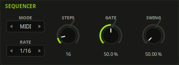

Set **Mode** to Sequencer and the plugin plays itself.

It runs off the **host's beat timeline**, re-read at the top of every block, so
scrubbing, looping and tempo changes all land where they should. Inside the
block the audio is split again at every step boundary, so a note starts on the
sample it is due on and not on the next buffer. If the host is stopped, or has
no transport at all, a held MIDI note runs the pattern anyway — at the project's
tempo, which a stopped host still reports, or at 120 BPM if there is no
transport at all — so it can be auditioned without putting the song into play.

A held MIDI note **transposes** the pattern rather than sounding. **C2 is the
pattern as written**; releasing everything puts it back.

When the pattern is running off a key rather than off the host's transport,
**pressing a key starts it again from step one**. That is the only way to place
the first step where you want it without a transport, and it is what the
machine's own keyboard did. With the host playing, a key only transposes: the
position belongs to the song, and a pattern that jumped back to step one in the
middle of a bar would be out of step with everything else in the project.

### How long a pattern is

**Steps** runs from 1 to 128, and the two ends of that are two different
instruments.

Below sixteen is the machine's own trick: fifteen steps against a four-four bar
walks the pattern around the beat, and the pattern never lands in the same place
twice until it has been round fifteen times. Sixteen is the machine.

Above sixteen the sequencer stops being a bass figure that repeats every bar.
Sixty-four steps is four bars of sixteenths, 128 is eight, which is long enough
to put a melody in rather than a riff. The pattern generator fills exactly as
many steps as Steps says, and its draws are per step and in order — so turning
Steps up **extends** the line the seed already described rather than replacing
it.

The grid draws sixteen columns for a pattern of sixteen or fewer and thirty-two
for anything longer, at half the cell width. Whatever does not fit is scrolled
to: roll the wheel anywhere over the grid, drag the bar under it, or click the
track either side of the bar to move a screenful. While the sequencer is
running the grid follows the playing step onto its own screen. The title says
which part of the pattern is on show — *PATTERN 1 33-64/128*.

### The grid

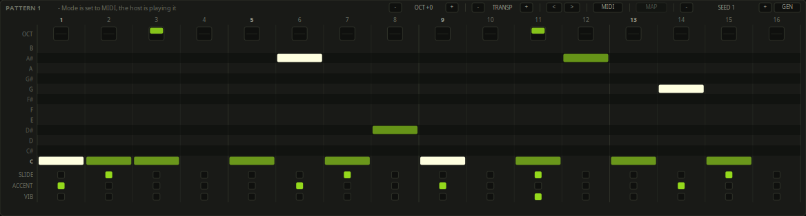

Sixteen steps across, below the panels — or thirty-two of a longer pattern, as
above.

- The **piano roll** is twelve semitones with C at the bottom and the black keys
  on darker lanes. Click a cell to put a note there, click it again (or
  right-click anywhere in the column) to clear the step, and **drag to paint**.
  An accented step is drawn bright — an accent is the first thing you look for
  when reading somebody else's pattern.
- **Drag along one row and you draw a long note.** It covers as many steps as
  you drag it over and is drawn as one continuous bar, and what it writes is
  the note on every step with a slide out of all but the last — which is what a
  held note has always been on this machine, entered in one gesture instead of
  eight. Drag back over it to shorten it. Leave the row and it is a new note,
  so a diagonal drag still paints a melody.

  The slide *is* the tie, so the SLIDE lane edits the length of a long note:
  turn one off in the middle and the bar splits into two notes at that step,
  turn it back on and it is one note again. A slide between two *different*
  pitches is a glide rather than a tie, and stays drawn as two notes, because
  that is what you hear.

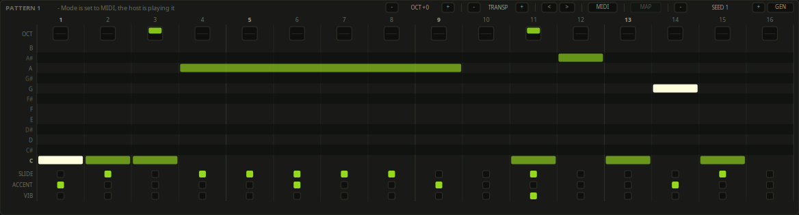

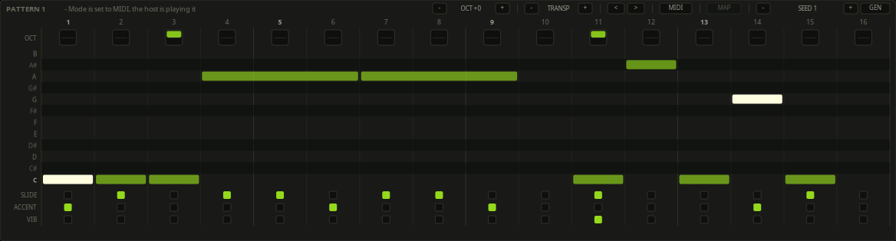
- The **OCT** row above it moves a step up to **two octaves either way**. Click
  the top half to step up, the bottom half to step down, one octave a click, as
  far as +2 and −2; the right button puts a step straight back to the middle.
  **Up is drawn in the accent green and down in amber**, and one octave fills
  half the box where two fill most of it — so which way is a colour and how far
  is a length, and neither has to be worked out from the other. The machine had
  one switch position each way; two is a sequencer feature, and it is what lets
  a line hold a bass note and a lead in the same sixteen steps.
- **SLIDE**, **ACCENT** and **VIB** below. Click or drag.
- Steps past the pattern's length are greyed; the playing step is lit.

The row above the grid is in sections, and the three that move the pattern
come first: **OCT** (see *Moving the whole pattern* below), **TRANSP**, and the
two **arrows**. Then **MIDI**, **MAP** and the generator.

The two **arrow** buttons walk the whole pattern one step sideways under the
bar, which is the quickest way to find out that a line you liked was starting in
the wrong place. To empty a pattern, use **DEL** in the bank.

**TRANSP −** and **+** move the whole pattern a semitone down or up, all 128
steps of it. A note that runs past B moves to C with its octave raised, and one
that runs below C moves to B with its octave lowered, so the line keeps its
shape across the grid's rows. At the very top or bottom — two octaves up from B,
two down from C — a note stops and waits there, and the pattern remembers where
it would have been: transpose back the same number of times and every note is
where it started, including the ones that were flattened against the edge.
Editing a note starts that memory again from what is on the grid; the flags do
not count, so an accent can be toggled in between.

**MIDI** drags the pattern out of the plugin — see *Taking the pattern with you*
below. The rest is the generator.

All of it applies to whichever pattern the bank has selected — which is not
necessarily the one sounding, because a running chain moves on without the
editor following it. The playhead is only drawn when the two are the same.

### Live mode, and playing patterns from a pad

Set **Mode** to **Live** and the keyboard stops transposing the pattern and
starts selecting them instead. Everything else about the sequencer is the same.

That swap is the whole feature. In Sequencer mode a held key moves the pattern
by semitones, which is what the machine's own keyboard did and is the wrong
thing entirely when you are standing in front of a pad controller and the thing
you want the pads to do is change pattern. In Live mode:

- **A key the map does not know about simply runs the pattern**, at the pitch
  it was written at. That is how you start it without a transport, exactly as
  before — you just no longer have to pick the right key.
- **A mapped key selects its pattern**, or steps the bank one either way. The
  pattern that is playing finishes first — see *Changing pattern while it
  plays* below.
- **Stepping stops at the ends.** Next on the last pattern stays on the last,
  prev on the first stays on the first. A pad that does nothing at the end of
  the bank is better than one that lands on pattern 1 halfway through a bar.
- **Pattern Oct** moves the whole running pattern by octaves — see below.

**Building the map.** Press **MAP**, on the row above the grid; the bank turns
into the pad layout and says so. Then, for each pad:

1. Click what you want it to do — a pattern in the bank, or the **PREV** or
   **NEXT** button under it.
2. Play the note you want to do it. That is the whole of the learning.

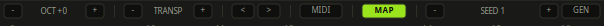

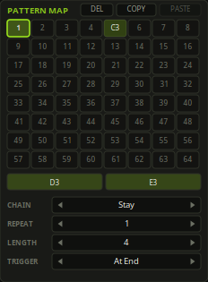

The cell or button then shows the note that reaches it. **Right-click** one to
unbind it, and right-click **MAP** to clear the whole map at once. Press MAP
again to go back to the ordinary bank. Selecting a pattern with the mouse is
unaffected while the map is open, so a layout can be built while a pattern
plays.

Two things worth knowing:

- **One note does one thing.** Learning a note onto a new target takes it off
  whatever it did before, so a pad cannot quietly end up doing two jobs.
- **The map is saved with the project, not with the preset.** A pad layout
  belongs to your rig rather than to a sound, and browsing presets in the
  middle of a set must not silently remap the controller. Nothing in a preset
  file mentions it.

PREV and NEXT are ordinary buttons the rest of the time, and step the bank when
clicked — the same call the pads make, so the two cannot drift apart.

### Moving the whole pattern: Pattern Oct

**OCT**, with its **−** and **+** beside the MAP button, moves the entire
running pattern by octaves without touching a single step. Click the reading
itself to put it back to zero.

It exists because Live mode takes the keyboard away, but it is not limited to
Live mode: in MIDI and Sequencer mode it adds to the held-key transpose, so a
line written low can be played an octave up without rewriting it or holding
anything down. It is an ordinary parameter, so a host automates it like a knob.
A step that would land outside MIDI's own range is clamped rather than wrapped,
so a pattern pushed four octaves up flattens at the top instead of folding back
into the bass.

### The pattern bank

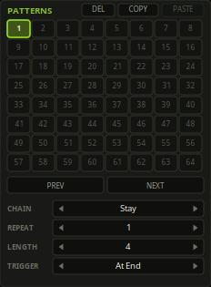

Beside the grid, eight by eight: **sixty-four patterns**. Click one to edit it,
or roll the wheel over the grid to step through them. A pattern with something
written in it is filled, the selected one is outlined in the accent, the one
sounding is ringed, and the ones the chain will reach are lit.

The machine had sixty-four too, and a mode switch to reach them.

**DEL**, **COPY** and **PASTE**, in the bank's own title row, are how the bank
is kept. COPY and PASTE make a pattern a variation of another one: copy it,
click an empty slot, paste, and change the two steps you wanted to change.
PASTE stays greyed until something has been copied, and DEL until there is
something to delete. The clipboard is the editor's — it lasts as long as the
window is open, and it is not in the preset, the state or the parameter list.

**DEL empties the selected pattern**, all 128 steps of it and not only the part
on screen. Like everything else here it is not
undoable, which is the deal a hardware sequencer offers — and the reason to
COPY first if there is any doubt.

**Every pattern has its own CHAIN and REPEAT.** The two rows under the bank
show and set them for the pattern on screen, so a chain is a route through the
bank: pattern 1 four times, pattern 2 once, pattern 3 twice and back to the
start, with each pattern saying where it goes next.

**CHAIN** is what happens when the pattern has played through.

| Chain | After it has played REPEAT times |
|---|---|
| **Stay** | play it again, for ever. The hardware's behaviour, and the default. |
| **Next** | go on to the following pattern, wrapping round to pattern 1 at **Length**. |
| **First** | go back to pattern 1. |
| **Random** | go to a pattern picked from inside the chain. |

**REPEAT** is how many times the pattern plays before its chain moves on, from 1
to 256. Stay ignores it.

**LENGTH** is how many patterns the chain covers, counting from pattern 1: where
Next wraps round and what Random picks from. Unlike the two above it is one
setting for the whole bank. A pattern outside the chain that is set to Next hands
on to pattern 1.

While a chain is running, the grid follows it: the pattern on screen, the
bank's cursor and the playhead are always the pattern that is playing, and an
edit, GEN, PREV, NEXT or a MIDI drag acts on that pattern.

Which pattern plays is worked out from the host's beat position, walking the
chain from the pattern selected when the sequencer started — for the same reason
the steps are. A loop, a seek or a scrub therefore lands on exactly the pattern it
should, Random included: the same bar of the song always picks the same pattern,
however it was reached. A pattern picked while the chain runs is where the chain
carries on from once it takes over. Changing a pattern's CHAIN or REPEAT while it
plays changes what comes next, not the way it got there.

**Changing pattern while it plays.** **TRIGGER**, under LENGTH, says when a
pattern selected while the sequencer is running takes over:

| | |
|---|---|
| **At End** | the default. The one playing runs to its last step, and the new one starts on its first — so a change can be pressed anywhere in the bar and still land on the beat. |
| **Instant** | the new pattern takes over on the next step and carries on from the same place in it, for cutting between patterns in the middle of a bar. |
| **Restart** | the new pattern takes over on the next step as well, but plays from its first step. |

Until it takes over, the new pattern's number flashes in the bank and the
PATTERN title over the grid flashes with it. With the sequencer stopped, a
selection takes effect at once. The same goes for PREV, NEXT, the mouse wheel,
a mapped key and host automation: in At End, automation placed on a pattern
boundary lands exactly there, and automation placed inside a pattern waits for
its end. After a Restart the pattern runs shifted against the bar until the
transport stops or jumps.

The selected pattern, the chain length and the trigger are ordinary parameters,
so a host can automate a pattern change like any other knob. Each pattern's
chain and repeat belong to the pattern, like its steps. The steps inside a
pattern are not parameters either, and deliberately so — eighty values per
pattern would make a mess of any host's parameter list. The consequence is that a
pattern edit is not automatable and the host's undo does not see it, which is the
same deal a hardware sequencer offers.

The whole bank travels in the preset file and in the plugin's state. Only the
patterns with something in them are written out.

### Taking the pattern with you

A line worth keeping is often a line you want to *edit* — in the arranger, as
notes, with the rest of the track around it. There are two ways out, and they
carry the same thing.

**The note output port.** The plugin has a note output as well as an input, and
in Sequencer mode everything the sequencer plays goes out of it: route it to
another track and record the line as it plays. What comes out is what you hear,
including the transposition a held key applies.

**Drag the MIDI button.** Press **MIDI** above the grid and drag into the host's
arranger. The selected pattern is written to a temporary `.mid` file and dropped
where you let go — which is how a DAW takes MIDI from anything else. A click
that does not move drops nothing.

Both use the same three conventions, and they are the ones this plugin reads
back in MIDI mode, so a recording played into it again sounds like what it came
from:

| In the pattern | In the MIDI |
|---|---|
| **Accent** | a velocity above the **Acc Thresh** parameter — 127, against 80 for a plain step |
| **Slide** | the note is still held when the next one starts. The overlap *is* the slide |
| **Vibrato** | CC1 up for the length of the note and back down after it |
| **Octave**, **Gate**, **Rate**, **Swing** | the key, the length and where the note falls |

The dragged file carries the project's tempo and a 4/4 time signature, at 960
ticks to the quarter note — which divides exactly by three, so a triplet rate and
a triplet swing both land on whole ticks rather than between two of them.

| Control | Range | Default | |
|---|---|---|---|
| **Mode** | MIDI / Sequencer / Live | MIDI | Where the notes come from, and in Live what the keys are for. See §2 and §6. |
| **Rate** | 1/32 – 1/8 | 1/16 | How long one step lasts. The triplet settings are not something the hardware could do. |
| **Steps** | 1 – 128 | 16 | How many steps before it repeats. The machine stopped at 16, and the interesting part of that range is the bit that is not 16: fifteen sixteenths against a four-four bar walks the pattern round the beat and comes back after fifteen bars. Past 16 it stops being a bass figure that repeats every bar — see §6. |
| **Gate** | 0 – 100 % | 50 % | How much of its step a note holds. It does not apply to a step marked Slide — that one holds past the next step's start on purpose. |
| **Swing** | 50 – 75 % | 50 % | Delays every second step. 66.7 % is triplet swing. The hardware's steps were exactly even. |
| **Pattern** | 1 – 64 | 1 | Which pattern the grid edits, and the one the chain starts from. |
| **Chain** | Stay / Next / First / Random | Stay | What happens when a pattern has played through. |
| **Chain Length** | 1 – 64 | 4 | How many patterns the chain covers. Only Next and Random use it. |

### Vibrato *(added)*

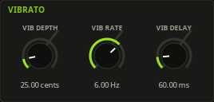

| Control | Range | Default | |
|---|---|---|---|
| **Vib Depth** | 0 – 200 cents | 25 | How far a vibrato step bends. In MIDI mode the mod wheel (CC1) scales it, since there is no step to carry the bit. The top of the range is a whole tone either way — past vibrato, and into something the note is doing on purpose. |
| **Vib Rate** | 0.5 – 20 Hz | 6 Hz | How fast. |
| **Vib Delay** | 0 – 400 ms | 60 ms | How long the note waits first, after which it ramps in over 80 ms. At zero it is already wobbling when the note starts, which sounds like a mistake rather than like playing. A slide does not restart the wait. |

## 7. The pattern generator

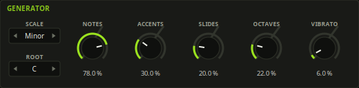

A seed, a scale, a root and five densities. **The same settings always give the
same sixteen steps**, so a line worth keeping is a number you can write down
rather than a file you have to find.

**GEN** gives a new pattern, every press. It picks a seed you have not heard
and generates from it, which is what the button is for -- press it until
something good happens. The seed it picked is shown beside it and is an
ordinary parameter, so the line you just kept is a number: write it down, and
it comes back.

Step the seed with the **−** and **+** buttons beside the grid and the pattern
regenerates as you go, one seed at a time. That is the other way to use it:
hold the settings still and walk through seeds until one of them is the one.
Those two buttons are the deterministic half, GEN is the dice.

Two things make it a generator rather than a random number generator wired to a
piano roll.

**It changes one thing at a time.** Every step draws all of its random values
whether or not it uses them, so turning Accents up changes which steps are
accented and leaves the notes exactly where they were. A generator that
reshuffled the line on every tweak would be a slot machine. Octaves are the one
deliberate exception: a jump is far likelier on an accented note, because
accent-plus-octave is *the* gesture, so moving the accents does move some
octaves.

**It knows some things about bass lines.** The root comes up far more often than
any other degree and almost always starts the pattern; the first step of each
beat is likelier to sound and likelier to be the root; octave jumps prefer
accented notes; and a slide into a rest is taken out afterwards, because it
slides into nothing. Uniform noise over twelve semitones does not sound like a
bass line and never did.

Measured over 400 seeds: the root is **44 %** of all generated notes, rests are
19 %, and octave jumps 21 % with a third of them downward.

| Control | Default | |
|---|---|---|
| **Seed** | 1 | Which pattern. **0 – 4,294,967,295**, which is the whole of a 32-bit word and is wide enough to take a Unix timestamp — so "seed it from the clock" is a thing you can actually do here, and you will not hear the same line twice. The **−** and **+** buttons step it and wrap at both ends; **click the reading to type one**, which is the only way across a range this size. It is the one control in this table that is **not** on the GENERATOR panel: it is up beside the step grid, next to the − and + buttons that step it and the GEN button that rolls it, which is where it is used. It is an ordinary parameter either way and a host automates it as one. |
| **Scale** | Minor | Which notes it may use. Minor is where nearly every acid line lives; Chromatic is for when it should not make sense. |
| **Root** | C | What the scale is built on. It moves the notes inside the octave rather than transposing the result — to move the line, hold a MIDI note. |
| **Notes** | 78 % | How many steps get a note at all. The rests matter more than they look: a pattern with a note on every step has no shape. |
| **Accents** | 30 % | |
| **Slides** | 20 % | Worth keeping low. A slide only reads as one when the notes around it do not. |
| **Octaves** | 22 % | Mostly up; one jump in three is down. |
| **Vibrato** | 6 % | Nothing on the machine does this, so the default is sparing. |

## 8. Presets, folders and packs

Presets are text files in your own preset directory
(`$XDG_CONFIG_HOME/SaeureKiste/presets`, or `%APPDATA%\SaeureKiste\presets` on
Windows), and the thirty factory presets are compiled into the plugin.

### Four kinds of preset

A preset is one of four kinds, and the kinds differ in what loading one
replaces:

| Kind | Holds | Loading it replaces | Where |
|---|---|---|---|
| **Scene** | the sound, the pattern bank and the effects | everything | the SCENE field on the bar |
| **Patch** | the sound and the pattern bank | the sound and the patterns -- the effects stay as they are | the PATCH field beside it |
| **FX chain** | the effects and the two crossovers | the effects -- the sound and the patterns stay | the FX CHAIN field on the FX page (§9) |
| **Effect** | one effect: its type and every control on its strip | that one strip -- its place in the chain and its Position stay | the PRESET field on every strip (§9) |

So a Scene is a Patch and an FX chain at once, and the two can be swapped
independently: keep the effects and try another line under them with PATCH, or
keep the line and try other effects with FX CHAIN. Every factory preset is a
Scene, and every Scene can be loaded as a Patch -- the PATCH browser lists them
all -- which is how a factory line goes under effects of your own.

Each field has its own arrows, which step through the presets of its kind, its
own browser, opened by clicking its name, and its own SAVE. A field shows the
preset it came from, with a star once something it holds has been changed by
hand; loading a Scene fills SCENE, PATCH and FX CHAIN at once.

**SAVE** puts a Scene in your library's root unless you type a folder in front
of the name, and the other kinds on shelves of their own: *Patches*, *FX
Chains*, and one per effect type for Effects -- *Delay Effects*, *Filter
Effects* -- so the browser groups them by what they are. Typing `Folder/Name`
saves anywhere, for any kind. What kind a file is lives in the file, not in its
folder, so a preset moved to another folder or handed over in a pack still
loads as what it is.

### The browser

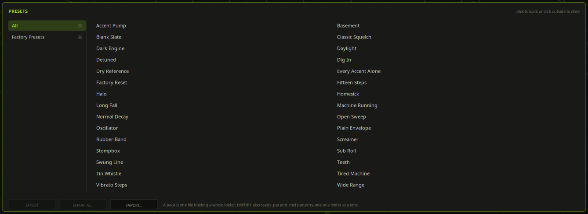

**The library has folders.** Down the left of the browser is a column of them:
*All*, then *Factory Presets*, then whatever you have made, then *Unfiled* for
presets saved without a folder. Click one to see what is on it; the count
beside each is how many presets it holds. A folder is one directory under your
preset directory — one level deep, because a preset library is a shelf rather
than a filesystem.

**A folder is made by saving into it.** In the save field, type `Folder/Name`
instead of a name: the folder is created if it is not there and the preset lands
in it. There is no second dialog and no way to make an empty folder, which is
the right answer for something whose only job is to hold presets.

**A preset pack is a whole folder as one file** — `<name>.saeurekistepack`,
which is the preset format again with a separator line between the presets, so
it can be read and edited by hand like everything else here. The footer of the
browser has three buttons:

| Button | |
|---|---|
| **EXPORT** | Writes the selected folder to `…/SaeureKiste/packs/<folder>.saeurekistepack` and says where it went. |
| **EXPORT AS…** | The same, through the desktop's own file chooser, for handing the pack to somebody else. Only shown when there is a chooser to open — zenity or kdialog on Linux, the system one on Windows. |
| **IMPORT…** | Lists the packs in the packs folder, plus *Other file…* for one from anywhere else and *Pattern folder…* for patterns written by another instrument. |

An import never overwrites anything: the pack becomes a new folder named after
itself, and importing the same pack twice gives two folders rather than a
mixture of both versions in one. A pack carries each preset's text exactly as it
was written, so the patterns inside a preset travel with it.

### Importing patterns from elsewhere

*Pattern file…* and *Pattern folder…* in the IMPORT menu read somebody else's
patterns — one at a time, or a whole directory at a time. Every pattern file
under the folder you pick becomes a preset: one shelf per directory, named
after that directory. Point it at a single pack of patterns and you get one
shelf; point it at the folder they all live in and you get all of them at once.
A single file lands on the shelf its own folder would have made, so importing
one now and the rest later puts them together.

Two kinds of file are read. **`.mid` and `.midi`** are ordinary MIDI files, of
the sort any DAW or pattern library will give you. **`.pat`** is the pattern
format written by AudioRealism Bassline.

**A MIDI file comes back the way this plugin writes one.** A velocity at or
above the accent threshold becomes an accent, a note still sounding when the
next step begins becomes a slide, and a step bracketed by the modulation wheel
becomes a vibrato — the same three things the plugin's own MIDI output and its
drag-out use. So a pattern dragged into your DAW, edited there and imported
again is still the pattern it was.

**A file that repeats is reduced to what repeats.** Pattern libraries are often
written as four bars of a one-bar figure; that imports as one bar, because that
is the pattern. A file that does not repeat exactly is left at its full length,
up to the 128 steps the sequencer holds. The grid is sixteenths, and the
instrument is monophonic, so one note per step.

Three shapes of `.pat` are read — ABL2's four columns, ABL3's six, and the XML
patch a Reason rack writes under the same extension. Which one a file is comes
from what is in it rather than from what it is called, so a folder holding a
mixture imports in one go. A `.param` file sitting beside a `.pat` of the same
name is that pattern's knob settings on their own; it is picked up with the
pattern and takes precedence over the settings in the pattern's own header,
which is often the shorter list. A `.param` with no `.pat` beside it holds no
pattern and is skipped.

What arrives is the line itself — the notes, their octaves, the slides and the
accents, exactly as the file has them, with a step whose gate is off imported
as a rest. A file that holds several patterns fills that many slots of the
bank. A line written higher or lower than a step can carry on its own is moved
as a whole with Pattern Oct rather than flattened, and Mode is set to
*Sequencer*, so an imported preset plays its pattern the moment the host's
transport runs.

The knob settings in the file's header come across too — tuning, cutoff,
resonance, envelope modulation, decay, accent, waveform, volume and, where the
file has them, drive and distortion. **Treat them as a starting point rather
than as a copy.** They arrive as positions on this instrument's own controls,
and two instruments modelling the same machine still do not share the same knob
curves, so an imported preset lands in the right area and wants a nudge. The
file's own tempo is not imported at all: tempo here belongs to the host.

### The factory library

| Preset | |
|---|---|
| **Factory Reset** | The machine's own middle position, and the reference the others were built against. Leaves the pattern bank alone. |
| **Blank Slate** | The same, and the sequencer with it: the bank emptied down to one bar of C in pattern 1, no octaves, slides, accents or vibrato anywhere. Where you start when you want to write a line rather than edit one. |
| **Dry Reference** | Every added stage off: no drive, tone fully open, master at unity. The signal path the schematic draws and nothing else. Start here when comparing against a recording. |
| **Classic Squelch** | Resonance high, envelope sweeping nearly its whole range, decay short enough that the peak falls back before the next sixteenth. |
| **Dark Engine** | The square wave, low and almost closed. |
| **Open Sweep** | Decay at 1.6 s, so the filter never finishes closing between notes and the line reads as one movement. |
| **Long Fall** | Decay at the knob's maximum, 2.5 s. |
| **Sub Roll** | Env Mod at zero: no sweep, no bias shift, just a filtered oscillator holding the bottom. |
| **Accent Pump** | Sweep Time at 180 ms, well past the circuit's 68. Accents build instead of repeating. |
| **Every Accent Alone** | Sweep Time at 20 ms. Nothing carries over. The same instrument with the hardest-to-hear half removed. |
| **Screamer** | Resonance near the top with the drive hard into its clipper. |
| **Tin Whistle** | The square up where it is thin rather than hollow. |
| **Rubber Band** | Slide Time at 150 ms — longer than a sixteenth, so slid notes arrive between the two pitches they were written as. |
| **Wide Range** | Filter tracking at 60 %, for a line written across three octaves. |
| **Detuned** | Fourteen cents flat, against anything else in the track that is exactly in tune. |
| **Normal Decay** | Acc Decay matched to Decay: accents stay louder and brighter but stop being shorter. |
| **Oscillator** | Res Range at 120 %, so the ladder sings instead of ringing. |
| **Tired Machine** | Drift at 55 %. Nothing quite holds still. |
| **Plain Envelope** | Env Bias at zero — the gimmick switched off, for comparison. |
| **Stompbox** | The germanium pedal model, driven hard enough that its gain corner sits up around 700 Hz — so the harmonics distort and the fundamental does not. Written low with octave jumps, and both octaves keep their weight. |
| **Dig In** | The crunch channel, which clips about three times higher than most overdrives. An unaccented step barely reaches it; an accented one hits it hard. The distortion is played rather than set. |
| **Halo** | The lead channel at 30 % Dist Mix — underneath the line instead of instead of it. On its own it is a thin saturated buzz; mixed in, it is a band of upper harmonics that sustains through the decay. Long tied notes, because that is what it flatters. |
| **Teeth** | Beastly. Resonance at 92 %, the accent sweep pushed to four and a half octaves and the drive at 85 %, with almost every step accented — so the accent circuit never empties. |

Eight of them are about the sequencer rather than the sound, and are the place
to start if you want to hear the plugin play itself:

| Preset | |
|---|---|
| **Machine Running** | Mode set to Sequencer: press play in the host and the pattern runs, locked to the timeline. Sixteen steps, three slides and four accents, at the settings the rest of the library was built around. |
| **Fifteen Steps** | The same with Steps at 15. Fifteen sixteenths against a four-four bar never lands in the same place twice and comes back round after fifteen bars. |
| **Swung Line** | Swing at 66.7 %, which puts every second step exactly where a triplet would be, with a short gate to let the shuffle breathe. The hardware could not do this at all. |
| **Vibrato Steps** | A vibrato on four of the sixteen steps, delayed 90 ms so it arrives after the note starts. Another thing the machine cannot do. |
| **Daylight** | Happy: a major pentatonic line with no minor third anywhere in it, played short and bright, both slides moving upward. |
| **Homesick** | Sad: natural minor at half the speed, a long decay and a gate that nearly fills its step, ending on a note that does not resolve. |
| **Basement** | Dark: the square wave an octave down, cutoff almost shut, seven notes in sixteen steps so most of the bar is the tail of the last one. |

### Driving their own sequencer

| Preset | |
|---|---|
| **Machine Running** | The plain case: sixteen steps, three slides, four accents. |
| **Fifteen Steps** | The same with Steps at 15, so the pattern walks around the bar. |
| **Swung Line** | Swing at 66.7 %, which the hardware could not do at all. |
| **Vibrato Steps** | Eighth notes with a vibrato on four of them. |
| **Daylight** | *Happy.* Major pentatonic, short and bright, a little swing, both slides moving upward and not a minor third anywhere in it. |
| **Homesick** | *Sad.* Natural minor at half speed, long decay, a gate that nearly fills its step so notes lean into each other, and a delayed vibrato on two of them. Ends on a D that does not resolve. |
| **Teeth** | *Beasty.* 92 % resonance, Acc Sweep at 4.5 octaves, the drive at 85 % and the ladder driven half again as hard as the circuit drives it. Almost every step accented, so with Acc Build at 85 % the accent circuit never empties and the whole bar climbs. |
| **Basement** | *Dark.* The square an octave down, cutoff almost shut, a decay long enough that the filter never finishes closing. Minor seconds and tritones, seven notes in sixteen steps, and Acc Decay at 600 ms so an accent swells instead of stabbing. |

## 9. The FX

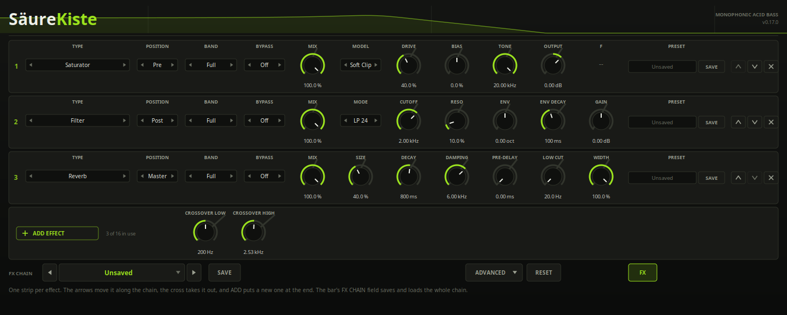

An effect chain of up to sixteen inserts, and the one stage of this instrument
that is not the machine, not a model of it, and not trying to be. It exists
because the whole point of the silverbox is what the oscillator does *into* the
ladder, and that is only reachable if something can be put between the two.

The **FX** button on the preset bar switches the window to the page the effects
are edited on, and back. The page replaces the panels and the grid rather than
sitting under them: a strip of controls wants the whole window, and a strip is
exactly one row of cells, so a slot holds the same knobs and chips a panel does.
The sequencer keeps playing while the page is up.

**The page shows the effects you have, not the slots the plugin could hold.** An
empty chain is one line of text, with **ADD EFFECT** and the two band crossovers
in the row under it; each ADD puts
another strip on the page, at the end of the chain where you can hear it before
it is configured, and the window grows to fit. The cross at the right-hand end
of a strip takes that effect out and moves the ones behind it up. There is no
undo for a removed strip -- its settings go with it.

**The arrows move an effect, settings and all.** The two chevrons on a strip
send it one place earlier or later in the chain, so putting the same delay
before the filter instead of after it is two clicks rather than retyping a
delay. The number at the left-hand end is the strip's place in the chain, and it
moves with the effect. An automation lane belongs to a place in the chain, not
to an effect, so a lane drawn for strip 3 stays with strip 3 when the effect on
it moves: build the chain first, then automate it.

**The page scrolls.** Past five strips the window stops growing and the list
scrolls instead, with the wheel or the bar at the right-hand edge; the strips
that are off the page are still in the chain and still running. Sixteen is the
most a chain can hold, and the ADD button says so when it is reached.

**The page is never shorter than the Type list.** Twenty entries is a long
list, and a window only as tall as the chain it holds would clip it -- so the
page keeps the height that list needs even when the chain is empty. Opening
Type on a strip low down flips the list above the strip rather than off the
bottom.

### Where a slot sits

Every slot has a **Position**, and it is the reason there are three buses
rather than one chain at the end:

| Position | Where | What it is for |
|---|---|---|
| **Pre** | Between the oscillator and the ladder | Shaping the wave the filter is about to be asked to track. A bandpass, a wavefolder or a saturator here is a different instrument from the same effect afterwards, because the ladder's own resonance and saturation respond to what arrives. |
| **Post** | After the amplifier's drive stage | What a pedalboard after the machine would do: the note is finished, and the slot shapes the finished note. |
| **Master** | After the built-in delay, at the very end | The last thing in the box. This is where a limiter, a final EQ or a reverb belongs. |

**Pre and Post are different sounds; Post and Master are the same sound until
the delay is switched on**, because the delay is the only thing between them.
That is not a limitation, it is what the two names mean: Post is the end of the
instrument, Master is the end of everything including the unit's own delay.

Slots run in the order the page shows within the bus they chose, so a set of
them reads down the page: the first strip before the second, whatever buses
they are on.

**Pre is stereo even when the instrument is not.** With one unison voice there
is one ladder, so what a Pre slot sends into it is the middle of its two sides.
An effect that treats both sides alike is unaffected by that; a ping-pong delay
or a stereo widener in front of the ladder is heard folded to mono, with every
echo in it. With unison spreading the voices, each side has a ladder of its own
and Pre is as wide as everything after it.

### The six controls every slot has

| Control | Range | Default | |
|---|---|---|---|
| **Type** | nineteen effects, or Off | Off | Which effect the slot runs. Picking one rewrites what its letters mean and puts them at that effect's defaults. |
| **Position** | Pre, Post, Master | Pre | Above. A slot added with ADD EFFECT starts on Master. |
| **Band** | Full, Low, Mid, High, Low+Mid, Mid+High | Full | Which part of the spectrum the slot processes. The split is flat -- the bands sum back to what went in -- so a band split changes no level. |
| **Bypass** | Off, On | Off | Takes the slot out without losing its settings. It fades rather than cuts. |
| **Mix** | 0 – 100 % | 100 % | How much of the slot's output is heard. A delay slot *adds* its echoes to the input rather than replacing it, so this is the level of the echoes. |
| **A – F** | *from the type* | *from the type* | Six letters whose name, range, default and unit all come from the slot's Type. |

The letters are why the page can hold nineteen effects with only six columns of
controls: a slot is six general-purpose controls that take their meaning from
the type. The same slot shows **Model, Drive, Bias, Tone, Output** as a
Saturator and **Low, Mid, Mid Freq, Mid Q, High, Tilt** as an EQ, and the host
shows the same names. A letter a type does not use is dimmed and does nothing
rather than disappearing.

To the host every letter runs from 0 to 1 whatever the type, because a host
expects a parameter's range never to change; the value it displays is in the
type's own units. An automation lane drawn for a letter therefore keeps its
shape when the type changes, and means something else under the new type.

### The types

Every letter glides over a few milliseconds like the knobs on the panels, so a
moved control or an automation lane does not click. A choice -- a model, a
mode, a sync value -- switches at once.

| Type | Letters | |
|---|---|---|
| **Saturator** | Model, Drive, Bias, Tone, Output | The drive stage's ten models with a tone control after them and a DC blocker, as an insert. |
| **Clipper** | Drive, Knee, Ceiling | A gain into a clipper whose corner is adjustable from a hard edge to a soft one, oversampled. |
| **Wavefolder** | Drive, Bias, Shape, Output | Folds the wave back on itself; Bias moves where the fold happens, so it folds asymmetrically. Oversampled. |
| **Bitcrush** | Bits, Rate, Output | Bit depth and sample rate, the second of them down to a hundred hertz. Its aliasing is the effect, so it is not oversampled. |
| **Filter** | Mode, Cutoff, Reso, Env, Env Decay, Gain | A plain state-variable filter -- twelve and twenty-four dB low/high pass, band pass, notch and peak -- with an envelope of its own, started by every note. Gain is the level after the filter, or the bell's gain in Peak mode. |
| **EQ** | Low, Mid, Mid Freq, Mid Q, High, Tilt | Three bands and a tilt. Flat at its defaults. |
| **Compressor** | Threshold, Ratio, Attack, Release, Knee, Makeup | A feed-forward compressor with a soft knee. |
| **Transient** | Attack, Sustain, Speed, Output | Shapes the front of a note and the tail after it, from -100 % to +100 % each. |
| **Gate** | Mode, Threshold, Attack, Hold, Release, Range | In Gate mode it follows the level; in Hit mode it opens on every note and closes after Hold, which is how a tail that will not stop is stopped. |
| **Reverb** | Size, Decay, Damping, Pre-Delay, Low Cut, Width | A small algorithmic room, sized for a bass line rather than a hall. |
| **Delay** | Time, Sync, Feedback, Color, Drive, Ping-Pong | Its own delay, separate from the instrument's: it can follow the host's tempo, with a filter and a soft clip in the loop. Mix is the level of the echoes. |
| **Warp** | Time, Sync, Feedback, Pitch, Mode, Diffusion | A delay whose repeats change: each pass is shifted by Pitch, played backwards, or read as four taps. |
| **Smear** | Time, Diffusion, Stages, Width | A short chain of allpasses: it spreads a note out in time without adding a tail. |
| **Ring Mod** | Mode, Frequency, Env, Env Decay | Ring modulation or a frequency shift up or down, whose frequency can be swept by its own envelope. |
| **Stereo** | Width, Haas | Width above 100 % and a short delay between the channels, which is the oldest trick there is for making one voice fill two speakers. |
| **Utility** | Gain, Polarity, Channels | Gain, an invert, and a choice of stereo, mono, swapped or one side. |
| **Limiter** | Gain, Ceiling, Release | A peak limiter with no lookahead, so it adds no delay, for a Master slot. |
| **Comb** | Start, Spacing, Bands, Gain, Width, Taper | A bank of tuned bells: below 0 dB a comb of notches, above it of peaks. |
| **Guard** | Window, Fade, Depth | A window after each note during which the slot holds its input down, and a fade out of it. In front of a saturator it keeps the drive from flattening the attack; after a reverb it takes the reverb's front off. |

**A slid note is not a new note**, here as everywhere in this instrument. The
things in the list above that are started by a note -- the Filter's envelope,
a Gate in Hit mode, a Guard's window and Ring Mod's oscillator -- are started by
a note that begins, not by one that slides from the last.

### The band split

**Band** runs the slot on the whole signal or on one band of it. The split is a
Linkwitz-Riley fourth order at the two crossover controls, which belong to the
chain rather than to any slot and so sit in the row under the strips, beneath
the Band column -- **Crossover Low** at 200 Hz and **Crossover High** at
2.53 kHz by default. Because the
bands sum back to what went in, a slot on Low passes everything above it
untouched; a Mid+High slot is the one that leaves the bass alone, which is
usually what a bass instrument's distortion wants.

### FX chain presets and effect presets

The effects have two preset kinds of their own (§8 has all four).

**FX CHAIN**, on the bar while the FX page is up, is the whole chain: every
effect, where each one sits and the two crossovers. Loading one replaces the
chain on whatever patch is loaded and leaves the sound, the pattern bank and
the selected pattern alone -- a chain is something you build once and try on
several lines. Its SAVE puts it on the *FX Chains* shelf.

**PRESET**, on every strip, is that one effect: its type and every control on
the strip. Loading one sets the strip and keeps its place in the chain and its
Position, so a favourite delay can go before the ladder or after the delay
alike. Its SAVE puts it on a shelf named after its type -- *Delay Effects* --
and its browser opens on that shelf. An effect preset loaded from the host's
own preset browser has no strip to go into, so it is added at the end of the
chain, as ADD EFFECT would add it.

### What it does to a preset that has never heard of it

Nothing. The chain is empty in all thirty factory presets, and an empty slot is
not in the signal path at all. Every preset in the library renders bit for bit
what it rendered before the FX existed, at 44.1, 48 and 96 kHz, and so does a
project saved with an earlier version.

### Things worth knowing

- **The Saturator is not the DRIVE panel.** It runs the same ten models, but it
  is an insert with its own settings; the DRIVE panel is the stage that was
  added to the machine, and it stays where it is.
- **The chain is reordered with the arrows, not by dragging.** A drag on a strip
  would have to mean both "move this effect" and "turn this knob", and the knob
  is the more common of the two.
- **A chain preset replaces the whole chain.** Loading one empties the strips the
  file does not name, because a short chain on top of a long one would leave the
  tail of the old one playing underneath it. A Scene does the same, because it
  is everything; a Patch never touches the chain.
- **A long tail keeps the plugin awake.** While a delay or a reverb in the chain
  is still sounding the plugin tells the host it is busy, and it tells the host
  how long the longest tail can be, so a bounce does not cut it off.

## 10. The window

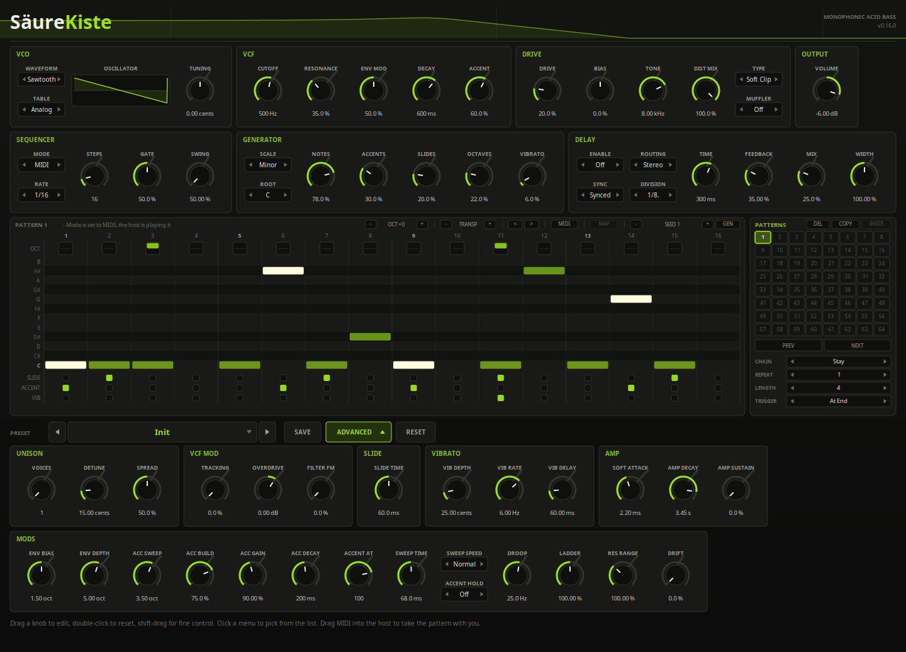

One row of knobs across a wide, shallow panel, which is the shape of the machine
it models — and a second row of them behind a button, because ten of the
controls are for tuning the engine rather than for playing it.

- **Drag** a knob to edit it; **double-click** to reset it; **shift-drag** for
  fine control; **click a value** to type one.
- **Click a chip's arrows** to step an enumerated control, or the chip itself
  for its list.
- The **oscillator display** on the VCO panel is a knob too, for whichever
  control belongs to the selected waveform: drag, wheel, double-click and type
  into it the same way.
- The **Table chip's name** opens the wavetable selector, and its arrows step
  through every table, the ones in your folder included.
- The **preset bar** has two preset fields, SCENE and PATCH (§8), each browsing
  the factory library and anything in your own preset directory, with a
  **SAVE** of its own. On the FX page the first is FX CHAIN instead.
- **FX**, at the right-hand end, switches the window to the effects page and
  back (§9). It is a place rather than a disclosure, so it is always there, and
  it stays lit while it is showing.
- **SAVE** means the preset, except on the FX page, where it means the effects
  alone (§9).
- **ADVANCED**, beside SAVE, opens the collapsible half of the window: the
  UNISON, VCF MOD, SLIDE, VIBRATO and AMP panels, and the mods under them. The window grows
  to make room and shrinks again when you close it, and it remembers which way
  you left it. A host that will not resize a plugin editor on request will
  leave it clipped; everything in it is reachable from the host's own parameter
  list either way.
- **RESET**, beside ADVANCED, puts the whole instrument back to the machine it
  models: every mod, every control of the modification, the drive and the delay
  back to their defaults, which between them are the stock circuit, and the FX
  emptied, because the machine had none. It asks
  once — the button reads SURE? and wants a second click — because there is no
  undo for it inside the plugin. **The pattern bank is not touched**, and
  neither are Mode, Rate or which pattern is playing: it is the patch that goes
  back to nothing, not the arrangement.
- **Clicking the version label** plays one low accented note, so a preset can be
  auditioned without reaching for a keyboard.
- The curve across the **header** is the ladder's actual response — the same
  transfer function the DSP uses, unequal capacitor included — sweeping down
  after every note the way the envelope does.

## 11. The modified machine

The silverbox has one famous hardware modification, made and sold since the
early nineties, which adds eight controls the original never had. Its author
publishes a manual for it, and that manual is a good source of a different kind
from the service notes: it documents what each addition *does*, in numbers,
rather than printing a schematic. Everything in this chapter comes from it.

**Every control here defaults to the stock circuit.** That manual has a section
on limiting the modification to the original's own sounds, a table of where to
leave each control so the machine behaves like an unmodified one; those are the
defaults. It is not merely claimed, either: left where they are, these controls
give back exactly the audio the instrument made before any of them existed —
the same samples, not merely a similar sound.

### The controls

**Overdrive** *(VCF MOD)* is the oscillator's level into the filter. It is not
`Drive` — this one is in front of the ladder and `Drive` is behind it. 0 dB is
the fixed level the machine has. Above that the ladder's input pair stops being
linear and starts switching, which is the manual's "the filter operates under
duress"; the top of the range is its 66.6 times normal. At the bottom the
oscillator is gone altogether, and that setting is only interesting with
`Res Range` past 100 %: the filter sings on its own and Overdrive reintroduces
the oscillator by hand.

**Filter FM** *(VCF MOD)* feeds the amplifier's own output back into the filter
frequency, at audio rate. It is loudest where the signal is loudest, so it bites
hardest on accented notes and wherever Overdrive is up, and it needs resonance
to have anything to work with. A little is edge. A lot is what that manual calls a
spluttering chaotic mess, and that is exactly what it is. While it is up the filter
coefficients are recomputed every sample instead of every eighth, which is what
audio-rate modulation costs and why it is off by default.

**Muffler** *(DRIVE)* is a clipper on the output — Off, Soft, Hard. It only
touches signals that are already loud, and it leaves the bottom of the spectrum
alone, so what it takes off is the top of the loudest peaks rather than the
weight of the note. Measured on a stock line: Soft raises the spectral centroid
10 %, Hard 34 %, both within 1.5 dB of the same level. That is the buzz, not a
volume control.

**Soft Attack** *(AMP)* is how fast the amplifier opens on an unaccented note,
0.3 to 30 ms. The machine's is fixed by C41 and R134 at 2.2 ms, which is the
default and is as good as instant; an accented note always uses it whatever this
says. Turned up, the note swells instead of starting — the one thing the original
cannot do.

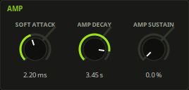

**Amp Decay** and **Amp Sustain** *(AMP)* are the volume envelope, which the
machine gives you no way to reach: R123 and C42 fix its decay at 1.5 s, reaching
a tenth in about 3.45 s, and that is the default. It is long enough that over a
sixteenth note nothing happens, which is why the machine's amplifier holds while the
filter falls. Shorten it and the notes start closing on their own. Amp Sustain
is where the decay falls to instead of silence, so a held note can run
indefinitely.

**Sweep Speed** *(MODS)* is how the accent circuit answers accents in quick
succession.

| | |
|---|---|
| **Normal** | The machine. Charge left in C62 from one accent makes the next one bigger — you poke it and it squeals, you poke it again and it squeals more. |
| **Fast** | The opposite. The output is the pulse that was just added rather than what has accumulated, so a residue makes the next one *smaller* and the first accent of a run is the strongest. |
| **Slow** | Rises more gently to about twice as far, and takes longer to cool, so it is still settling through the notes that follow. |

The manual describes what these three do without giving component values — there
is no schematic for the modification — so Normal is the machine and the other
two are fitted
to that description. `Sweep Time` and `Acc Build` remain the controls.

**Accent Hold** *(MODS)* accents every note whatever its step or velocity says.
The modification's front panel has a pushbutton for it.

### The widened ranges

Four controls kept their defaults and grew their travel:

| | Was | Now |
|---|---|---|
| **Cutoff** | 100 Hz – 2.5 kHz | 30 Hz – 5 kHz |
| **Decay** | 200 ms – 2.5 s | 30 ms – 3 s |
| **Slide Time** | 10 – 300 ms | 10 – 360 ms |
| **Res Range** | 50 – 130 % | 50 – 200 % |
| **Tracking** | 0 – 100 % | 0 – 200 % |

A project saved before this converts on load: for a logarithmic control the
saved value is a position on the curve, not a frequency, so widening the curve
would otherwise move it. Preset files were never at risk — they are written in
real units.

### What is not modelled

The part of the modification that is jacks: the external audio input into the
filter, the audio Filter FM input, the Filter Out tap, and the CV and gate
sockets. Those want an audio input port and a second output, which is a
different shape of plugin. The modification's MIDI retrofits need nothing at all here.

## 12. Where the numbers came from

Every number in this instrument is one of four things: read off the schematic,
printed in the service notes, derived from the two, or fitted because neither
gives it.

**The fitted ones are all controls.** They are the Mods panel, and the number
that was guessed is that control's default — so the guesses are a starting
point you can disagree with rather than decisions made on your behalf and
buried. That is the rule the whole instrument is built on: anything that could
be read off the circuit is fixed, and anything that could not is a knob.

The honest summary: this is fitted to a circuit diagram and an alignment
procedure. It has never been listened to against a real one.

## Appendix. Every parameter

The chapters above explain what each control is for and why it is where it is.
This table is the other half of that: the complete list, with every range and
every starting value, **generated from the instrument itself** when this manual
was built. It cannot disagree with the plugin you have.

{{PARAMETER_SUMMARY}}
