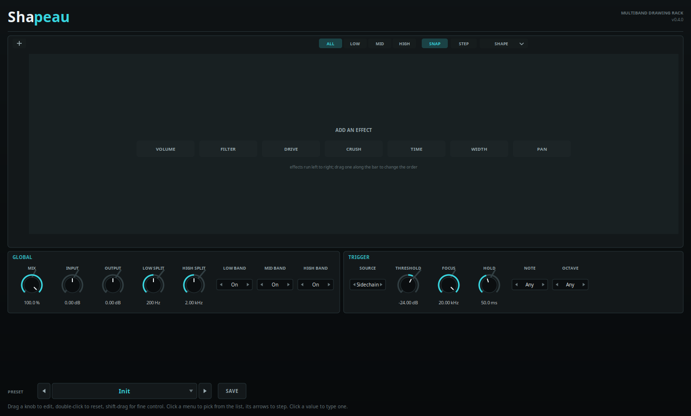
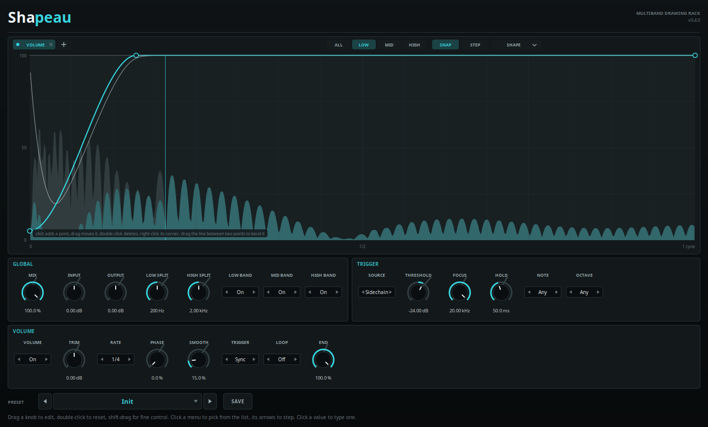
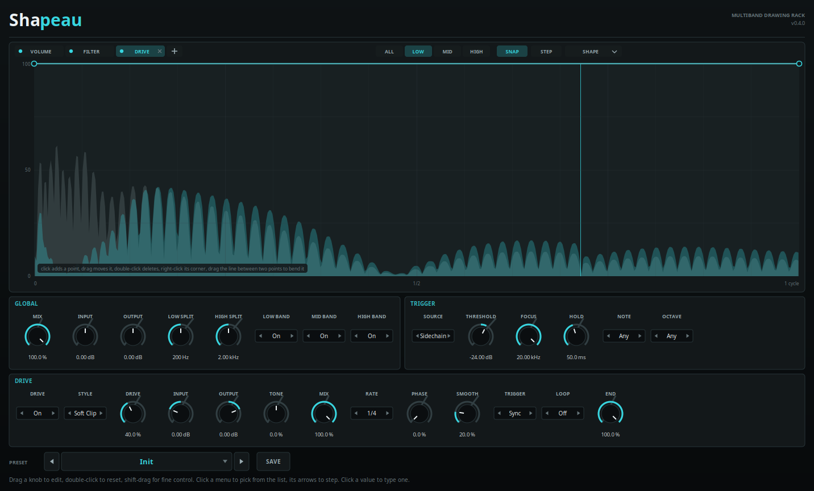
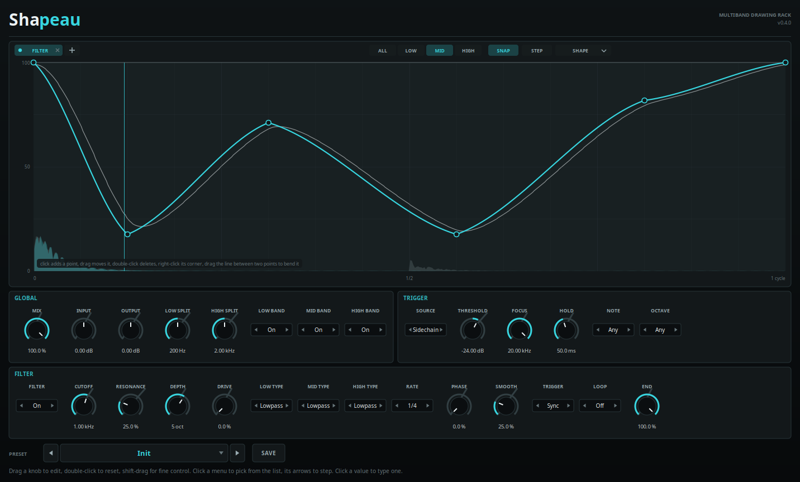
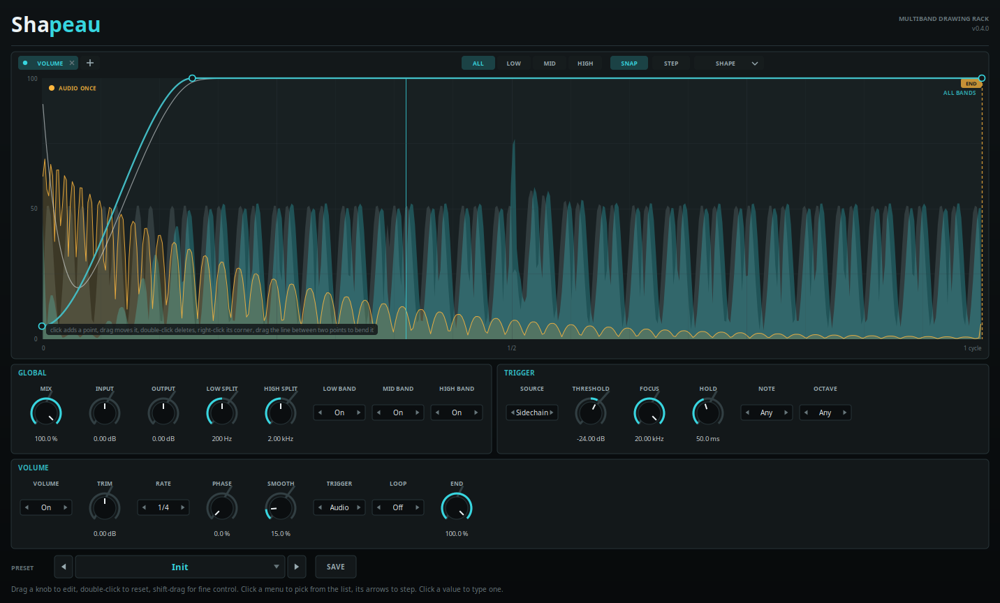

# {{PLUGIN}} — manual

*A multiband drawing rack. Linux and Windows, CLAP and VST3.*

Version {{VERSION}}

---

[TOC]

## 1. What it is

Shapeau is a chain of effects, each driven by a shape you draw: **volume**,
**filter**, **drive**, **crush**, **time**, **width** and **pan**, in whatever
order you put them in. The input is split into three frequency bands, and every
effect has a shape of its own in each band -- so a shape can duck the bass and
leave the top alone. Every shape runs locked to the host's beat, and the audio
it acts on is drawn behind it as it plays.

That is the whole idea. A ducking curve on the low band and a flat line on the
other two is a sidechain without a sidechain. A filter shape that falls once a
bar is a sweep. A drive shape with one hard step in it is distortion on the
hits only. A time shape that falls at the rate the buffer fills is a stutter
that holds a moment still; one that falls twice as fast plays it backwards.
A stepped crush shape puts rhythm into the grit, and a width or pan shape walks
a band across the stereo field. Each of these is a line drawn in the same
editor, and the band tabs decide who hears it.

A shape does not have to follow the beat. Any effect can be restarted by a MIDI
note or by a hit -- in the signal itself, or in a sidechain input, which is
where a kick from another track is routed to duck a bass to it. The sidechain
is drawn behind the shape too, so the duck can be fitted to the kick by eye.

The effects run in the order the chain lists them, the same order in every
band, and the three bands are summed back together and mixed against the dry
input. A filter before a stutter and a stutter before a filter are two
different sounds, and moving an effect is one drag.

Eighty-three parameters, ten presets.

## 2. The shape editor

The editor fills the top of the window, and under it are two panels: GLOBAL,
and the controls of the effect being edited. Its toolbar has four groups:

- **The effect bar**, on the left: the effects in the chain, in the order the
  audio runs through them. Click one to edit it -- its shape fills the editor
  and its panel appears below. Its **dot** switches it on and off without
  taking it out of the chain; the **×** that appears under the pointer takes it
  out; **drag** it left or right to move it in the chain; **+** adds an effect
  that is not in it yet, at the end. An empty chain shows all seven in the
  editor, one click from being added.
- **ALL, LOW, MID, HIGH** — which band's shape is being edited. **ALL** is the
  default: an edit goes to all three bands at once. Pick a band to draw it on
  its own. All three are always drawn; the selected one is bright and the other
  two sit dim behind it, so a shape can be drawn against what the other bands
  are doing.
- **SNAP** and **STEP** — the two editing aids: points land on a sixteenth of a
  cycle, and the mouse paints sixteen step cells instead of adding points.
- **SHAPE** — a menu of twelve starting shapes.

The horizontal axis is **one cycle** of that stage's shape — the stage's own
**Rate** (a note value) and **Phase**. The vertical axis is the shape's value,
from 0 at the bottom to 1 at the top, and what that value means is the stage's
business: gain for volume, cutoff position for filter, drive amount for drive,
crush amount, position in the past for time, a point between the speakers for
pan, and mono to double width for width. Pan and width do nothing at the
**middle** of their travel rather than at the top; every other stage's neutral
shape is a flat line at the top.

### What the editor shows

Behind the shape is the audio it acts on, drawn along the same cycle, so the
part of the shape at a point in time sits over the sound at that point in time.
**Grey** is what goes in, **in the accent** is what comes out; a duck drawn
down to the floor sits on the stretch of the waveform it empties. A vertical
line is the **playhead**, where the shape is being read right now.

Volume, filter, drive, crush and time draw the audio as its level, from the
bottom up; pan and width, which move the sound between the speakers rather than
change its level, as a waveform around the middle. With **ALL** selected the
picture is the whole effect's input and output; with one band selected it is
that band alone.

A **sidechain**, when one is routed in, is drawn in **amber** over both, so the
kick a bass is being ducked for sits right under the dip that ducks it. It is
only ever drawn and listened to, never heard. See section 5.

A thin pale line is the **modulation trace**: what the effect actually did after
its **Smooth**. With no smoothing it lies under the shape and cannot be seen;
with more, it rounds the shape's corners and lags behind its jumps -- which is
exactly what is heard.

### Drawing points

- **Click** in the graph adds a point where the pointer is.
- **Drag** a point to move it. It stays inside the cycle, and the two end points
  move up and down only, so the shape always covers exactly one cycle.
- **Double-click** a point deletes it.
- **Right-click** a point cycles its corner weight: hard, medium, soft. A hard
  point is a corner, medium rounds it halfway, soft is a flowing curve. The
  segment between two points follows the harder of the two weights, so one soft
  point smooths both of its sides.
- **SNAP** rounds a new or dragged point's time to the nearest sixteenth of a
  cycle, which is what you want when a shape has to land on the grid.

### Bending a segment

The line between two points is not fixed. Put the pointer on it — a small
handle appears at the middle of the segment — and **drag up or down**. The
segment bows towards the top or the bottom of the editor without its endpoints
moving; the same gesture as the curve handle in a DAW. It is how a rise becomes
an exponential snap and how a recovery becomes a long ease instead of a
straight line. **Right-click** the line to straighten it again.

The bend is stored per segment, in the preset, as the fourth number of the
point that starts it. A file written before bending existed still loads, with
straight segments.

### Step editing

**STEP** turns the editor into a sixteen-cell grid. Click a cell to set its
level, or drag across several cells to paint them; the shape becomes hard
steps with vertical edges. The step cells are fractions of the stage's cycle,
not note values: with Rate at 1/1 (one bar) sixteen cells are sixteenth notes,
with Rate at 1/4 (a quarter) they are sixty-fourths. Set the Rate to the grid
the pattern should land on.

**STEP** again returns to point editing, with the steps still there: each cell
boundary is a point, so a step shape can be nudged, bent or deleted like any
other shape. Switching to step mode converts the current drawing by sampling
it at the middle of each cell, so it is a conversion rather than a view — undo
is the preset it was loaded from.

### The shape menu

**SHAPE** opens twelve generators, which replace the selected shape (or all
three bands' shapes when ALL is selected):

- **FLAT** — the stage's neutral shape.
- **DUCK**, **GATE**, **RAMP UP**, **RAMP DOWN** — the four envelopes most
  often drawn by hand.
- **TRIANGLE**, **SQUARE**, **PULSE** — two-sided, half-open and a short burst.
- **SINE** — a full tremolo or pan sweep.
- **STAIRS** — eight descending steps.
- **RANDOM** — sixteen fresh random steps every time it is chosen.
- **EXPO RISE** — a rising curve with the bend already applied, which is the
  quickest way to see what bending does.

They are a starting point, not a preset: draw over them.

### Drawing switches the stage on

A stage switched off with its dot stays in the chain, and a shape drawn into it
would be silently ignored. So drawing — adding, moving or deleting a point,
bending a segment, painting a step or choosing a generator — switches that
stage on, and switches on the bands being edited. A small dot on a stage or
band tab marks one that is switched off. **FLAT** is the exception: it resets
the shape without switching anything on, so clearing a drive curve does not
add drive to the sound.

That, together with ALL as the default band, is the fix for the most common
first impression of the plugin: a volume stutter drawn on the mid band alone
leaves the low and high bands playing straight through, and a shape drawn into
a stage that is off does nothing at all.

The stage's own smoothing — **Smooth**, on each panel — is applied after the
shape, so a hard corner stays hard in the editor and still lands softly in the
sound.

## 3. How the rack is put together

**Low Split** and **High Split** set the two crossovers: 200 Hz and 2 kHz by
default. Both sides of each split are Linkwitz-Riley fourth order, in phase, so
the three bands sum back to the input — a flat shape in all three bands is
level-transparent, to within a tenth of a decibel.

**Low Band**, **Mid Band** and **High Band** switch a band's processing off. A
band switched off passes dry to the sum; the other bands are unaffected.

**Mix** blends the whole rack against the input, and **Input** and **Output**
trim either side of it. A rack that ducks or stutters is usually more useful
mixed in than in place, which is why Mix is there and why it is the first
control on the GLOBAL panel.

Nothing here adds latency: the stages filter and shape in place, and the time
stage reads backwards from where it is rather than delaying the output.

## 4. The stages

### Volume

The shape is a gain: 1 is unity and 0 is silence, and the panel's **Volume**
switch puts it in circuit. The curve is squared on its way to the gain, so a
point halfway down the editor is about **-12 dB** — which is where a duck
usually sits — rather than -6.

- **Trim** sets the stage's output gain, so a shape can dip deeply and still
  come back louder than it went in.
- **Rate** and **Phase** place the cycle. A duck drawn on the downbeat with a
  quarter note rate needs no phase; moving Phase to 25 % puts it a sixteenth
  early.
- **Smooth** rounds the gain. At zero the shape is followed exactly, which is
  what a hard gate wants; a little smoothing is what makes a duck sound like a
  compressor rather than a click.

A gate is the same stage with hard points and no smoothing: open for the first
two fifths of the cycle, shut for the rest.

### Filter

The shape is a **cutoff position**, not a cutoff: the top of the editor is the
**Cutoff** knob's value and the bottom is that value pushed down by **Depth**
octaves. So one shape can be a two-octave wobble at 400 Hz or an eight-octave
slam at 8 kHz depending on two knobs.

- **Cutoff** — where the top of the shape sits, 20 Hz to 20 kHz.
- **Depth** — how far below it the bottom of the shape reaches, 0 to 8 octaves.
  At zero the shape does nothing.
- **Resonance** — emphasis at the cutoff, up to the edge of self-oscillation on
  the state-variable filter this uses.
- **Drive** — saturation in front of the filter, inside the band. A resonant
  sweep that is driven excites its own harmonics instead of staying clean.
- **Low Type**, **Mid Type**, **High Type** — lowpass, highpass, bandpass or
  notch, chosen per band. The low band can be a lowpass while the high band is
  a notch, all driven by the same shape.
- **Rate**, **Phase**, **Smooth** — as on the volume stage. A filter that steps
  from one cutoff to another with Smooth at zero clicks; that is sometimes the
  sound and sometimes not.

### Drive

The shape scales the **Drive** knob: the top of the curve is the amount set on
the knob, the bottom is nothing driven at all. So a drive shape with a flat top
is a constant distortion, and one that opens on every hit is distortion that
arrives with the drums.

- **Style** — one transfer curve for all three bands: **Soft Clip**, **Hard
  Clip**, **Fold**, **Rectify**, **Sine Fold** and **Crush**. Rectify leaves DC
  behind; the stage removes it.
- **Input** and **Output** — gain either side of the shaper, separate from the
  amount, so the curve's top can be put where the shaper is interesting.
- **Tone** — a one-pole at 800 Hz mixed with the distortion: right takes the
  fizz off, left thins it out.
- **Mix** — the distortion against the band's clean signal. Below 100 % this is
  a parallel blend, which is where a driven bass keeps its bottom.
- **Rate**, **Phase**, **Smooth**.

The level compensation is the same curve for every style, on purpose: choosing
between two styles is choosing a character, not a volume. The **Crush** style is
the one exception in name only: it is a quantiser inside the drive stage, while
the separate **Crush** stage below can reduce the sample rate as well and is
shaped by its own curve.

### Crush

The crush stage is a bit-depth and sample-rate reducer, per band, driven by the
shape. The top of the curve is the **Amount** knob and the bottom is clean, so a
flat top is constant grit and a stepped shape is grit that arrives with the
drums.

- **Amount** — the amount the curve scales from, 0 to 100 %.
- **Bits** — the bit depth at full curve, 2 to 16. Six is a hard, grainy
  quantiser; sixteen is effectively clean.
- **Down** — the sample-rate division at full curve, 1 to 32. At 8 the signal is
  held for one sample in eight, which is the aliased, lo-fi half of a crusher.
- **Mix** — the crushed signal against the band's clean one. Below 100 % keeps
  a bass' weight under the grit.
- **Rate**, **Phase**, **Smooth**.

### Time

The time stage is a look-back buffer per band, **Range** long. The shape is the
read head's position in it: **1 is now** and **0 is one Range into the past**.

The two gestures worth knowing:

- A shape that **falls** at exactly the rate the buffer fills holds one moment
  still. That is the classic stutter, and it is why the stage's own
  smoothing is called Step.
- A shape that falls **steeper** than that reads the buffer backwards, which is
  how a reverse is drawn. A shape that rises from the bottom to the top and
  stays there plays the buffer forwards at double speed for that part of the
  cycle.

**Range** sets the look-back — 20 ms to 2 s. Short ranges are the tight stutter
(90 ms covers a sixteenth at 160 BPM); long ones are the tape stop.

- **Step** — how long the read head takes to travel when the shape jumps. This
  is the difference between a click at every step and a smooth stutter.
- **Smooth** — softens the drawn shape before it moves the read head, on top of
  Step.
- **Rate**, **Phase**.

### Width

The width stage is a mid/side width control, per band, with its own shape.
**The middle of the curve is the plain stereo image**, the bottom sums the band
to mono, and the top doubles the side signal. A width shape over an eighth note
is a band that breathes; a hard step from mono to wide is a tear, which is why
**Smooth** exists.

- **Rate**, **Phase**, **Smooth**.

Width is applied to a band after its time stage and before pan, so a band can be
narrowed in the middle and still be placed anywhere in the field.

### Pan

The pan stage places a band between the speakers. **The middle of the curve is
the centre**, the bottom is hard left and the top is hard right. It is a
balance rather than a constant-power pan: the centre is unity, so a neutral
shape is transparent, and leaving the middle turns the opposite side down.

- **Rate**, **Phase**, **Smooth**.

A pan shape on the high band alone walks the top of a mix while the bottom holds
steady; one on all three bands is an auto-pan of the whole signal.

### Rate and Phase

Each stage has its own. **Rate** is the length of one cycle of that stage's
shape, in note values from a thirty-second to four bars; **Phase** is where in
the cycle the shape starts, from 0 to 100 %.

Rates are beats, so with the transport running they lock to the host's position
and survive a tempo change. With the transport stopped the shapes free-run at
the host's tempo, or at 120 BPM if the host offers none, so the editor and the
sound keep moving while a part is being played by hand.

Every stage also ends with **Trigger**, **Loop** and **End**, which decide
whether its cycle follows the beat at all; they are section 5.

## 5. Triggers and the sidechain

Every effect follows the host's beat until it is told otherwise. That is right
for a kick on every quarter note and wrong for anything else -- a broken beat, a
fill, a break with no kick in it at all. Each effect can instead be started by
something that happens.

### Trigger, Loop and End

The last three controls on every effect's panel.

- **Trigger** -- what starts the effect's cycle.
  - **Sync** follows the host's beat, as described under *Rate and Phase*. This
    is the default.
  - **MIDI** restarts the shape on every note that reaches Shapeau's note input.
  - **Audio** restarts it on every hit the detector finds -- in the sidechain,
    or in the signal itself (see *The TRIGGER panel* below).
- **Loop** -- **Off** runs the shape once from the trigger and stops at its End,
  where it holds until the next trigger. **On** keeps cycling until the next
  trigger starts it again.
- **End** -- where a shape run once stops. Turn the knob, or drag the dashed
  **END** marker in the editor; the part of the shape after it is dimmed,
  because it is never played. Sync and Loop ignore it.

A triggered shape still runs at its **Rate**, counted from the trigger instead
of from the start of the song, and **Phase** still shifts it. Until its first
trigger it rests at its End -- or, with Loop on, at the end of the shape -- so
a duck drawn back up to the top lets the sound through untouched until the
first kick arrives.

With an effect set to MIDI or Audio, the editor's picture starts at the trigger:
the hit that started the cycle is at its left edge. A lamp in the top left
corner of the editor, beside the trigger mode, lights on every trigger.

### Ducking a bass from the kick

1. Put Shapeau on the bass track.
2. Route the kick track into Shapeau's **sidechain input**. Every DAW does this
   its own way; it is the same routing a compressor's sidechain uses.
3. Add **Volume**, pick **DUCK** from the SHAPE menu, and set **Trigger** to
   **Audio**. The factory preset *Sidechain Duck* is this, ready made.
4. Play. The kick appears in amber behind the shape. Drag the points until the
   dip covers the part of the kick that needs the room, and set **Rate** so one
   cycle is about as long as the duck should last.

To duck only the bottom of the bass, draw the dip in the **LOW** band and leave
the other two flat.

The sidechain is drawn in every Trigger mode, Sync included: a duck that follows
the beat can be lined up with a kick on another track the same way.

### The TRIGGER panel

One setup, shared by every effect set to Audio or MIDI.

- **Source** -- what the Audio trigger listens to: the **Sidechain** input, or
  the **Input**, the signal Shapeau is processing.
- **Threshold** -- how loud a hit has to be. Once it has fired, the detector
  waits for the level to fall 6 dB below this before it can fire again.
- **Focus** -- a lowpass in front of the detector, never in the sound. At the
  top it hears everything; around 150 Hz it finds the kick in a full drum loop
  and ignores the hats and the snare's top. A low Focus finds the hit a few
  milliseconds later.
- **Hold** -- the shortest time between two audio triggers, so a kick with a
  doubled attack, or a flam, starts the effect once.
- **Note** and **Octave** -- which notes start an effect set to MIDI. **Any** in
  both answers to every note. C3 is MIDI note 48.

The quickest way to set Threshold is by the lamp: it should light once for
every kick and not for anything else.

### Timing

Triggers add no latency. A MIDI note restarts the shape where it falls, to
within a third of a millisecond. An audio trigger fires as the hit crosses the
threshold -- a fraction of a millisecond after it starts, a few with a low
Focus -- and the effect's **Smooth** rounds off the restart, so a duck drops in
without a click.

## 6. Presets

The preset bar at the bottom of the window holds the factory presets. The
arrows step through them, the field opens the browser, and **SAVE** writes the
current state — parameters, band switches and all twenty-one shapes — to a user
preset.

Factory presets are compiled into the plugin, so the `.clap` is all that has to
be installed. User presets are text files in the plugin's own folder
(`~/.clap/Shapeau/presets` on Linux, the same layout under `%APPDATA%` on
Windows) and are also offered to the host through CLAP's preset discovery, so
they show up in the DAW's own preset menu next to the factory ones.

A preset stores each shape as one line per stage and band, in normalised time
and value with the point's corner weight and its segment bend, which is why a
curve drawn by hand survives a save, a reload and a different install.

## 7. Parameter reference

{{PARAMETER_REFERENCE}}

## 8. Preset library

{{PRESET_LIBRARY}}

## 9. Notes

- **Formats.** CLAP (1.2) and VST3, 64-bit, for Linux and Windows.
- **Channels.** Stereo in, stereo out, plus a stereo sidechain input that is
  listened to and drawn but never heard, and a note input for the MIDI trigger.
  The band split, every stage except pan and width, and the drive are applied
  to both channels identically. Pan and width are the two stages that
  deliberately treat the channels differently.
- **Latency.** None. The time stage reads backwards from the present rather
  than delaying the output, the filters are minimum-phase, and the triggers
  react to a hit as it happens rather than looking ahead for it.
- **Tail.** The time stage's look-back plus the release of the filters behind
  it, reported to the host so a bounce does not cut a stutter short.
- **CPU.** Three bands, two channels, one filter, one shaper, one crusher and
  the stereo stages each. An effect that is switched off or not in the chain
  costs nothing; the band split runs regardless, because the bands have to be
  summed back. The picture behind the shape is drawn only while the window is
  open.
